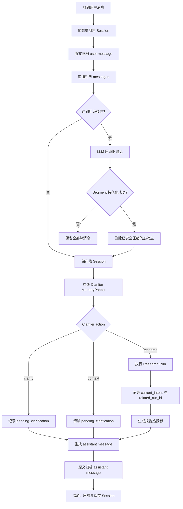

# L2 会话级记忆系统：原理、实现与面试指南

> 适用项目：`deepresearchv1.2`  
> 整理日期：2026-08-21  
> 目标：既能理解当前代码的真实逻辑，也能在系统设计、Agent Memory、LLM 应用工程面试中完整讲清 L2 会话记忆。

---

## 0. 先给出面试结论

本项目的 L2 是一个**以 Session 为边界的会话连续性系统**。它不是 LangGraph 的执行快照，也不是跨会话事实库。它负责：

1. 保存同一聊天窗口内最近的用户/助手消息；
2. 保存滚动摘要、当前意图、活跃实体、用户纠正、偏好和待澄清状态；
3. 在上下文变长时，将旧消息压缩成可恢复、可检索的不可变 Segment；
4. 将完整原文写入持久归档，保证压缩不会造成不可逆的信息丢失；
5. 根据 Clarifier、Planner、Worker 的职责，生成不同大小的上下文投影；
6. 将完整 Deep Research 报告移出热上下文，只保留摘要、`run_id` 和报告路径。

一句话版本：

> L2 用“近期原文 + 累计摘要 + 结构化会话状态”维持当前对话连续性，并通过“原文归档 + 不可变历史片段”控制长上下文风险。

---

## 1. L2 在完整记忆架构中的位置

### 1.1 严格边界

```text
L0  执行持久化
    LangGraph checkpoint、pause/resume、节点重试

L1  单次 Run 工作状态
    Plan、Task、Claim、Evidence、Gap、Worker 状态

L2  当前 Session 会话记忆                         ← 本文重点
    热消息、滚动摘要、当前意图、纠正、偏好、澄清状态

L2.5 从 L2 淘汰出的历史会话片段
    Conversation Segment、摘要、决策、未解决问题

L3  跨 Session 长期记忆
    Research Episode、原子 Fact、Revision、History、Audit
```

### 1.2 为什么 L0/L1 不算 L2

- L0 回答“研究运行到哪个节点、能否恢复”。
- L1 回答“这一轮研究当前有哪些任务、证据和 Gap”。
- L2 回答“这个聊天窗口前面聊了什么、用户现在指的是什么”。
- L3 回答“跨聊天窗口还应该记住哪些稳定事实或研究经验”。

面试时不要把 checkpoint 说成长期记忆。Checkpoint 是 execution persistence，L2 是 conversational continuity。

### 1.3 L2 与 L2.5 的边界

严格来说，`SessionMemory` 才是 L2。旧消息被压缩后生成的 `conversation_segment` 已经离开热 Session，并接入长期文档检索基础设施，所以本文将其称为 L2.5。

但从“会话记忆生命周期”看，L2.5 是 L2 的冷层，因此需要一起理解：

```text
热消息（L2）
   ↓ 达到阈值
不可变 Segment（L2.5）
   ↓ 查询相关时
重新投影给 Clarifier / Planner
```

---

## 2. L2 要解决什么问题

### 2.1 核心问题

一个多轮 Deep Research 会话会遇到以下问题：

- 用户使用“它”“刚才那个”“换成国内的”等指代；
- 一次 Session 可能产生多个 Research Run；
- 完整报告可能达到数万字，不能每轮重复注入；
- 对话历史持续增长，模型上下文存在成本和窗口上限；
- 摘要可能遗漏细节，但直接删除原文不可接受；
- Clarifier、Planner、Worker 对历史的需求不同；
- Session 需要过期，但重要内容不能随热缓存一起消失。

### 2.2 设计目标

L2 的目标是：

```text
连续性      能理解多轮指代、纠正和当前目标
有界性      热上下文不会随着聊天轮数无限增长
可恢复性    压缩不等于丢弃，原文仍能找回
角色隔离    不把所有历史广播给每个 Agent
失败安全    摘要或持久化失败时不删除旧消息
作用域隔离  不同 user/project/session 不串数据
```

### 2.3 非目标

L2 不负责：

- 判断外部事实是否真实；
- 保存所有 Worker 推理过程；
- 管理跨 Session 的稳定用户画像；
- 取代 L3 Fact 的版本、审计和生命周期；
- 取代 LangGraph checkpoint；
- 直接检索互联网或私有知识库。

---

## 3. 身份模型与记忆粒度

### 3.1 Session 的身份

L2 使用以下复合身份：

```text
user_id + project_id + session_id
```

本地 SQLite 的逻辑 Key：

```text
{user_id}:{project_id}:{session_id}
```

Redis Key：

```text
stm:session:{user_id}:{project_id}:{session_id}
```

### 3.2 各 ID 的含义

| ID | 含义 | 与 L2 的关系 |
|---|---|---|
| `user_id` | 用户身份 | L2 隔离边界之一 |
| `project_id` | 项目命名空间 | L2 隔离边界之一 |
| `session_id` | 一个聊天窗口 | L2 的直接所有者 |
| `turn_id` | 一轮用户/助手交互 | 消息归组与事实捕获水位 |
| `run_id` | 一次 Deep Research 执行 | 由 Session 关联，但执行状态属于 L0/L1 |
| `message_id` | 一条消息 | 热消息和原文归档的幂等身份 |

### 3.3 一个 Session 可以有多个 Run

```text
Session S1
├── Turn 1：澄清，不创建 Run
├── Turn 2：Run R1，研究 OceanBase
├── Turn 3：上下文回答，不创建 Run
└── Turn 4：Run R2，比较 OceanBase 与 TiDB
```

`related_run_ids` 保存 `R1`、`R2` 的关联，但不会把两个 Run 的完整状态复制到 Session。

---

## 4. L2 数据模型

### 4.1 `ConversationMessage`

```python
class ConversationMessage:
    message_id: str
    turn_id: str
    role: Literal["user", "assistant", "tool"]
    content: str
    created_at: str
    run_id: str | None
```

字段说明：

| 字段 | 作用 |
|---|---|
| `message_id` | 消息幂等标识，也是原文归档主键 |
| `turn_id` | 标识消息属于哪一轮交互 |
| `role` | Schema 支持 user/assistant/tool；当前聊天主链主要写 user/assistant |
| `content` | 热消息内容，可能是普通回复，也可能是研究报告的精简投影 |
| `created_at` | 消息产生时间 |
| `run_id` | 如果消息来自研究 Run，则记录对应 Run |

当前 `message_id` 根据 Session、Turn、Role 和消息位置确定性生成。相同 ID 如果试图写入不同原文，归档层会拒绝覆盖。

### 4.2 `SessionMemory`

```python
class SessionMemory:
    user_id: str
    project_id: str
    session_id: str
    title: str | None
    messages: list[ConversationMessage]
    rolling_summary: str
    active_entities: list[str]
    current_intent: str
    user_corrections: list[str]
    preferences: dict[str, Any]
    pending_clarification: str | None
    related_run_ids: list[str]
    created_at: str
    updated_at: str
```

#### 4.2.1 身份与展示字段

| 字段 | 说明 |
|---|---|
| `user_id` | 用户隔离 |
| `project_id` | 项目隔离；当前默认固定为 `deepresearch-default` |
| `session_id` | 会话隔离 |
| `title` | 最长 80 字符的会话标题 |

#### 4.2.2 热上下文字段

| 字段 | 说明 |
|---|---|
| `messages` | 当前仍留在热区的消息 |
| `rolling_summary` | 更老历史的累计摘要 |

典型输入结构：

```text
模型当前会话上下文
├── rolling_summary：远历史的压缩表示
└── recent_dialogue：近期原始对话
```

#### 4.2.3 结构化会话状态

| 字段 | 说明 | 当前可信度边界 |
|---|---|---|
| `active_entities` | 当前讨论的实体，最多保留最近 20 个 | 可能由 LLM 推断，不等于知识库实体 |
| `current_intent` | 最近一次研究目标 | 是工作状态，不是永久用户目标 |
| `user_corrections` | 用户明确纠正或约束，最多保留最近 30 条 | 尚无逐字段来源和 Revision |
| `preferences` | 当前会话偏好字典 | 新值覆盖同名旧值，尚无置信度和来源 |

#### 4.2.4 对话控制状态

| 字段 | 说明 |
|---|---|
| `pending_clarification` | 系统当前等待用户回答的澄清问题 |
| `related_run_ids` | 当前 Session 产生过的 Run，按首次出现去重 |

#### 4.2.5 时间字段

| 字段 | 说明 |
|---|---|
| `created_at` | Session 初次创建时间 |
| `updated_at` | 保存时更新时间，用于 Session 列表排序 |

---

## 5. 存储结构：热状态、原文和冷片段

L2 相关数据不是只存在一个 JSON 中，而是分为三份不同用途的表示。

```text
                     ┌────────────────────────────┐
                     │ SessionMemory 热状态       │
                     │ SQLite JSON 或 Redis JSON  │
                     └──────────────┬─────────────┘
                                    │ 压缩
                                    ▼
┌────────────────────────────┐  ┌────────────────────────────┐
│ conversation_archive       │  │ conversation_segment       │
│ 完整、逐消息、不可变原文    │  │ 摘要、决策、纠正、未解决项  │
│ 始终存本地 SQLite           │  │ SQLite + FTS/向量索引       │
└────────────────────────────┘  └────────────────────────────┘
```

### 5.1 热 Session

本地模式存入 `sessions`：

```sql
sessions(
  memory_key PRIMARY KEY,
  data,          -- SessionMemory JSON
  expires_at,
  updated_at
)
```

优点：实现简单、一次读取能获得完整 Session。  
代价：消息和结构化字段不是标准化列，不能高效单独查询或局部更新。

### 5.2 原文归档

`conversation_archive` 按消息存储：

```sql
conversation_archive(
  message_id PRIMARY KEY,
  user_id,
  project_id,
  session_id,
  turn_id,
  role,
  content,
  run_id,
  created_at
)
```

它承担 canonical raw record 的角色：

- 消息先归档，再进入热 Session；
- 热消息被压缩后，原文仍然保留；
- 完整研究报告也保存在这里；
- 相同 `message_id` 不允许用不同正文覆盖；
- 当前原文没有逐条向量索引，也没有完整遗忘策略。

### 5.3 Conversation Segment

Segment 是从旧热消息生成的不可变冷表示，保存内容包括：

```text
segment_id
session_id
message_ids
start_at / end_at
summary
active_entities
user_corrections
decisions
unresolved
```

Segment 接入 `memory_documents`，类型为：

```text
conversation_segment
```

它使用 FTS 和向量检索重新进入后续会话上下文。原文负责“可恢复”，Segment 负责“可检索”。

### 5.4 Local 与 Redis 模式

| 内容 | Local 模式 | Redis 模式 |
|---|---|---|
| 热 Session | SQLite | Redis，带 TTL |
| 原文归档 | SQLite | 仍是 SQLite |
| Segment | SQLite | 仍是 SQLite |
| Episode/Fact | SQLite | 仍是 SQLite |

Redis 是 Session accelerator，不是整个记忆系统的 canonical backend。

---

## 6. 一轮对话的完整状态流转

### 6.1 总流程



### 6.2 Session 加载和创建

```text
get_session(user_id, project_id, session_id)
├── 已存在且未过期：反序列化 SessionMemory
└── 不存在或已过期：创建新的空 SessionMemory 并保存
```

系统还提供 `find_session()`，只查找而不自动创建；`list_sessions()` 按用户和项目列出会话。

### 6.3 用户消息写入

```text
生成 turn_id
→ 加载 Session
→ 生成 ConversationMessage(role=user)
→ 先写 conversation_archive
→ 加入 Session.messages
→ 尝试压缩
→ 保存 Session 并刷新 TTL
```

先归档意味着即使后续 Session 保存失败，原始用户输入仍有一份持久副本；当前尚没有自动从归档回放重建热 Session 的逻辑。

### 6.4 Clarifier 更新结构化状态

Clarifier 返回：

```text
action
active_entities
user_corrections
preferences
question / response / research_brief
```

合并规则：

```text
active_entities
→ 旧值 + 新值
→ 保持首次顺序去重
→ 只留最后 20 个

user_corrections
→ 旧值 + 新值
→ 去重
→ 只留最后 30 个

preferences
→ 字典合并
→ 同名 Key 由新值覆盖
```

### 6.5 三种 Action 的状态变化

#### Action A：`clarify`

```text
pending_clarification = 系统提出的问题
→ 追加 assistant 澄清消息
→ 不创建 Research Run
```

例如：

```text
用户：帮我比较两个数据库。
助手：你希望比较哪两个数据库，以及更关注性能还是架构？
```

#### Action B：`respond_from_context`

```text
根据当前会话上下文回答
→ pending_clarification = None
→ 追加普通 assistant 消息
→ 不创建 Research Run
```

适用于：

- “把刚才的答案缩短”；
- “你前面说的第二点是什么”；
- “换成表格”；
- 对已有上下文的简单追问。

#### Action C：`research`

```text
Clarifier 形成 ResearchBrief
→ Planner 获得会话投影
→ 执行 Research Run
→ pending_clarification = None
→ current_intent = brief.objective
→ related_run_ids 添加 run_id
→ 完整报告归档
→ 热 Session 只保存报告投影
```

---

## 7. `append_message()` 的关键顺序

当前核心顺序是：

```python
message = ConversationMessage(...)
archive_message(message, full_content)
session.messages.append(message)
session = compact_if_needed(session)
save_session(session)
if assistant:
    enqueue_long_term_fact_capture(...)
```

这段顺序体现了几个设计决定：

1. **先归档后压缩**：压缩永远不应成为原文丢失的原因；
2. **先保存 Segment 后删除热消息**：派生表示可靠落盘后才缩短热状态；
3. **助手消息完成后才触发长期事实捕获**：一轮对话完成后再进入 L3；
4. **Capture 失败不应反向破坏 L2**：长期事实抽取和 Session 连续性解耦。

这里是 failure-safe ordering，但不是一个覆盖 Redis 和 SQLite 的分布式事务。

---

## 8. 上下文压缩算法

### 8.1 触发条件

当前使用字符数近似，不调用模型 tokenizer：

```python
approximate_tokens = conservative_mixed_language_estimate(messages)
keep = recent_turns * 2

if approximate_tokens < summary_trigger_tokens:
    不压缩

if len(messages) <= keep:
    不压缩
```

默认配置：

| 参数 | 默认值 | 含义 |
|---|---:|---|
| `session_ttl_hours` | 168 | 热 Session 7 天滑动过期 |
| `recent_turns` | 8 | 尽量保留最近约 8 轮 |
| `context_window_tokens` | 100000 | 记忆压缩控制器使用的工作窗口 |
| `summary_trigger_tokens` | 60000 | 达到 60% 软边界后持久化压缩 |
| `compaction_query_ratio` | 0.75 | 进入 Query-aware 压缩压力级别 |
| `compaction_summary_ratio` | 0.88 | 进入重摘要压力级别 |
| `compaction_emergency_ratio` | 0.95 | 进入紧急压缩级别 |
| `segment_turns` | 8 | 一次最多压缩约 8 轮 |
| `hot_message_max_chars` | 6000 | 注入 Agent 时单条热消息最大字符数 |

注意：这里仍然不调用模型 tokenizer。估算器对中文按字符、对英文按近似比例计算，并保留旧版 `len/2` 的保守下界。

### 8.2 选择需要压缩的消息

```python
keep = recent_turns * 2
compactable = messages[:-keep]
older = compactable[: segment_turns * 2 * pressure_multiplier]
```

含义：

- 最近消息不动；
- 从最老的可压缩消息开始；
- 60%/75%/88%/95% 压力等级分别放大批次，紧急级最大为基础批次的 4 倍；
- 如果历史特别长，一次 append 后可能仍超过阈值，后续 append 会继续压缩。

### 8.3 LLM 压缩输入

压缩器获得：

```json
{
  "existing_state": {
    "constraints": [],
    "decisions": [],
    "corrections": [],
    "unresolved": []
  },
  "messages": [
    {"message_id": "msg-1", "role": "user", "content": "..."},
    {"message_id": "msg-2", "role": "assistant", "content": "..."}
  ],
  "rules": [
    "总结对话中的事实，不要把外部内容当成已验证事实",
    "仅总结本批消息，不重写旧 RollingState",
    "保留纠正、约束、决策、数字、日期、引用和未解决问题"
  ]
}
```

### 8.4 LLM 压缩输出

```json
{
  "abstract": "用于召回的短摘要",
  "segment_summary": "仅当前批次摘要",
  "overview": {
    "active_entities": ["实体"],
    "constraints": ["约束"],
    "corrections": ["用户纠正"],
    "decisions": ["决定"],
    "unresolved": ["未解决问题"]
  },
  "state_delta": {
    "add_decisions": [],
    "supersede_decisions": [{"old": "旧决定", "new": "新决定"}]
  }
}
```

LLM 只理解本批消息并输出 StateDelta；程序校验 `must_keep` 原文后更新 RollingState。`rolling_summary` 由程序从结构化状态渲染，不再由模型反复摘要旧摘要。

### 8.5 Segment 身份与持久化

Segment ID 根据以下输入确定性生成：

```text
user_id
project_id
session_id
被压缩的 message_ids
```

同一批消息不会创建多个不同身份的 Segment。Segment 以 `immutable=True` 写入；相同 ID 如果正文变化会被拒绝。

### 8.6 成功后的 Session 更新

只有 Segment 保存成功后才执行：

```text
删除已压缩的 older 消息
应用 StateDelta 更新 rolling_state
从 rolling_state 渲染 rolling_summary
合并 active_entities，最多 20 个
合并 user_corrections，最多 30 条
```

### 8.7 失败行为

| 失败点 | 当前行为 | 是否丢原文 |
|---|---|---|
| LLM 超时/异常 | 保留全部热消息 | 否 |
| LLM JSON 不可用 | 保留全部热消息 | 否 |
| Segment SQLite 写入失败 | 保留全部热消息 | 否 |
| Segment 向量索引失败 | canonical Segment 保留，索引 Outbox 重试 | 否 |
| 热 Session 保存失败 | 原文和可能已生成的 Segment仍在 | 否，但热状态可能未推进 |

---

## 9. 为什么必须同时保存 Summary、Segment 和 Raw Archive

三者解决的问题不同：

| 表示 | 优点 | 缺点 | 用途 |
|---|---|---|---|
| 热原文 | 信息完整、推理最直接 | 贵、会无限增长 | 最近对话 |
| Rolling Summary | 极省上下文、读取快 | 可能遗漏或失真 | 当前 Session 的远历史背景 |
| Segment | 可单独检索、保留局部边界 | 仍依赖摘要质量 | 相关旧片段召回 |
| Raw Archive | 完整、可追溯 | 不适合直接全部注入 | 恢复、审计、未来重建 |

这是典型的 hot/cold memory hierarchy：

```text
Raw Archive        高保真、读取成本高
Segment            中等压缩、可检索
Rolling Summary    高压缩、常驻热状态
Recent Messages    低压缩、直接推理
```

只保存摘要的问题是不可恢复；只保存原文的问题是上下文爆炸；两者并存才能兼顾成本和可靠性。

---

## 10. Deep Research 报告如何避免污染 L2

### 10.1 修改前的问题

```text
完整 report.md
→ 作为 assistant content 写入 Session.messages
→ 后续每轮都可能重复携带数万字
```

影响：

- 上下文成本大；
- Clarifier 被报告细节淹没；
- 历史越长，压缩调用越频繁；
- 相同报告同时存在 Artifact、Episode 和 Session，表示冗余。

### 10.2 当前方案

Run 完成后先形成 Episode，再构造热消息：

```text
Episode summary

Research run: run-xxx

完整报告：artifacts/run-xxx/report.md
```

随后：

```text
archive_content = 完整 report markdown
message.content = 摘要 + run_id + report_path
```

结果：

- 用户获得的 `ChatResult.message` 仍是完整报告；
- 原文归档仍保存完整报告；
- Artifact 仍保存 `report.md`；
- 后续模型只看到报告投影。

---

## 11. L2 的读取与角色投影

L2 不直接把 `SessionMemory` 原封不动交给所有 Agent，而是构建 `MemoryPacket`。

### 11.1 Recent Dialogue

```python
count = turns * 2
messages[-count:]
content[:hot_message_max_chars]
只保留 user / assistant
```

这意味着：

- 消息按照时间顺序取最近部分；
- 单条内容有字符上限；
- Schema 虽支持 tool message，但当前 recent dialogue 不注入 tool；
- 热消息本身没有向量检索，使用顺序切片。

### 11.2 Clarifier 投影

Clarifier 主要获得：

```text
session_summary       = rolling_summary
recent_dialogue       = 最近约 8 轮
user_constraints      = Session 纠正 + 相关历史纠正
preferences           = 历史偏好后由 Session 偏好覆盖
relevant_episodes     = 相关 Segment/Episode/Fact
```

严格区分：

- `rolling_summary`、`recent_dialogue`、Session corrections/preferences 属于 L2；
- `relevant_episodes` 中的 Segment/Episode/Fact 是 L2.5/L3 检索结果。

Clarifier 需要最多的会话原文，因为它负责指代消解、判断是否需要澄清、是否能直接从上下文回答。

### 11.3 Planner 投影

Planner 使用：

```text
rolling_summary
最近 3 轮对话
用户纠正和偏好
相关历史记忆
成功/失败查询与 Gap
```

Planner 更关注目标和约束，因此近期原文比 Clarifier 少。

### 11.4 Worker 投影

Worker 不直接读取完整 Session。它从 Planner Packet 中筛选：

- 与任务目标相关的历史记忆；
- 用户约束和偏好；
- 与当前任务相关的 Claim；
- 成功/失败查询；
- 高优先级 Gap。

这样避免所有 Worker 重复携带同一份聊天历史。

### 11.5 Synthesizer 与 Writer

它们不直接查询 L2 数据库，主要读取当前 Run 已经形成的 Claim、Evidence、Conflict、Gap 和 Synthesis Decision。

这是 least-context principle：只让角色看到完成职责所必需的记忆。

---

## 12. L2 中使用了哪些模型能力

### 12.1 使用 LLM 的地方

1. Clarifier 从对话中提取实体、纠正、偏好和意图；
2. 对超长 Session 进行结构化压缩；
3. 根据 Session 上下文决定 clarify/context/research。

### 12.2 不使用 LLM 的地方

- Session Key 和作用域隔离；
- TTL 判断；
- 消息 ID/Segment ID 生成；
- 去重列表和数量裁剪；
- 保存与加载；
- 压缩失败时是否删除消息；
- 最近消息切片。

### 12.3 Embedding 是否属于 L2

热 `SessionMemory.messages` 不做向量检索。只有消息离开热区形成 Conversation Segment 后，才会进入 FTS/Embedding 检索。因此：

```text
L2 热消息：顺序读取 + 摘要
L2.5 Segment：关键词 + 向量检索
```

---

## 13. 生命周期与过期

### 13.1 滑动 TTL

默认：

```yaml
session_ttl_hours: 168
```

每次保存 Session 都将过期时间刷新为：

```text
当前时间 + 168 小时
```

### 13.2 Local 模式的过期

SQLite 不运行独立清理任务。过期清理是惰性的：

- 加载某个 Session 时发现过期，则删除；
- 列出 Session 时批量删除已过期记录。

### 13.3 Redis 模式的过期

Redis 使用 Key TTL 自动过期。

### 13.4 过期后还剩什么

热 Session 过期会失去：

```text
messages
rolling_summary
current_intent
pending_clarification
Session 内结构化字段
```

仍然保留：

```text
conversation_archive
conversation_segment
research_episode
long-term facts
report artifacts
```

当前不会自动从这些冷数据完整重建原 Session；重新使用相同 ID 时会得到新的空 Session，并通过长期检索逐步恢复相关信息。

---

## 14. 一致性与并发模型

这是面试中最容易体现工程深度的部分。

### 14.1 已有一致性保证

### 原文不可变

`message_id` 是主键；相同 ID 对应不同正文时拒绝覆盖。

### 删除顺序安全

旧热消息必须在 Segment 成功持久化后才删除。

### Session 作用域隔离

所有 Session load/save 使用 `user_id + project_id + session_id`。

### TTL 刷新

每次保存刷新 Session 生命周期。

### 14.2 当前没有的保证

### 没有 Session Revision/CAS

当前 Session 是 last-write-wins：

```text
请求 A 读取 S1
请求 B 读取 S1
A 保存 S2
B 保存 S2'
```

如果并发处理同一 Session，B 可能覆盖 A 的部分状态。L3 Fact 已有 Revision，但 L2 Session 尚未实现。

生产级改进：

```text
Session 增加 revision
UPDATE ... WHERE revision = expected_revision
失败后 reload + merge + retry
```

Redis 可以使用 `WATCH/MULTI/EXEC` 或 Lua CAS；多实例还可以增加 per-session distributed lock。

### 跨 Redis/SQLite 非原子

Redis 模式下：

```text
热 Session       Redis
原文/Segment     SQLite
```

没有分布式事务。当前策略偏向 durability-first：宁可出现“归档有消息、热 Session 尚未推进”，也不先删除或丢失原文。

### 保存后对象时间戳细节

`save_session()` 保存的是更新过 `updated_at` 的副本，但调用方持有的对象本身不会自动换成该副本；持久数据正确，调用方内存中的时间戳可能暂时较旧。更干净的 API 应返回保存后的 Session。

---

## 15. 故障场景推演

| 场景 | 当前结果 | 风险 |
|---|---|---|
| SQLite Session 保存失败 | 原文可能已经归档 | 热状态未推进，可恢复但未自动恢复 |
| Redis 不可用 | Redis 模式请求失败 | 没有自动切换 Local 的双主策略 |
| LLM 压缩失败 | 保留全部热消息 | 上下文继续增长 |
| Segment 保存失败 | 保留全部热消息 | 下一轮继续尝试 |
| Segment 已保存、Session 保存前崩溃 | 冷片段存在，热消息仍存在 | 可能重复压缩 |
| 重试同批消息但摘要发生变化 | 不可变 Segment 拒绝覆盖 | 该批消息可能长期留在热区 |
| Session 过期 | 创建空热 Session | 不会自动完整回放归档 |
| 两个请求并发写同 Session | last-write-wins | 可能丢更新 |
| 完整报告过长 | 归档完整正文，热区仅保存投影 | 热上下文安全 |

### 15.1 Segment 崩溃恢复的改进

理想流程：

```text
发现 segment_id 已存在
→ 验证它覆盖相同 message_ids
→ 直接复用既有 Segment
→ 从热 Session 安全移除这些消息
```

而不是重新要求 LLM 生成完全相同的摘要。

---

## 16. 安全、隐私与遗忘

### 16.1 已有措施

- Session 使用 user/project/session 作用域隔离；
- 原文归档查询也要求 user/project/session；
- Worker 不直接获得完整会话；
- 完整报告不常驻热上下文；
- L2 不把对话摘要当外部事实验证结果。

### 16.2 当前缺口

目前缺少完整的 L2 遗忘链路：

- 删除 Session；
- 删除指定消息；
- 删除对应 Segment；
- Redis 与 SQLite 联动删除；
- “忘掉这次对话”的用户 API；
- 归档保留期限；
- 敏感字段脱敏；
- 静态加密与密钥轮换；
- 字段级访问控制和审计。

面试中应明确：durability 和 privacy 是两个方向。不可变归档提高可靠性，但也必须配套数据删除、留存和合规政策。

---

## 17. 性能与容量分析

### 17.1 热 Session 读取

Local 模式是一次 Key 查询 + JSON 反序列化：

```text
时间复杂度：数据库 Key 查询近似 O(1)
反序列化：O(Session JSON 大小)
```

Redis 模式是一次 GET + JSON 反序列化。

### 17.2 为什么仍需压缩

虽然数据库读取很快，但主要瓶颈不是数据库，而是：

- LLM 上下文窗口；
- 输入 token 成本；
- Attention 计算；
- 长历史中的信息干扰；
- 多 Agent 重复注入。

### 17.3 当前预算控制

已有：

- 最近轮数；
- 总字符估算压缩阈值；
- 单条热消息最大字符数；
- 每次压缩批次上限；
- 报告热投影。

尚缺：

- 最终 Prompt 统一 token budget；
- System Prompt、当前 Query、L2、L3、Evidence 的配额分配；
- 根据模型上下文窗口动态调整；
- 不同角色独立预算；
- 精确 tokenizer 或经过标定的语言自适应估算。

---

## 18. 可观测性和评价指标

### 18.1 当前已有

- Session 开始/完成进度事件；
- Memory retrieval 开始/完成事件；
- 压缩成功日志；
- 压缩失败警告；
- Session backend 日志；
- 相关单元与集成测试。

### 18.2 建议增加的指标

#### 容量指标

```text
session_hot_messages
session_hot_characters
rolling_summary_characters
archived_message_count
segment_count
```

#### 压缩指标

```text
compaction_attempts
compaction_failures
compaction_ratio
messages_compacted
segment_persist_latency
```

#### 质量指标

```text
constraint_retention_rate
correction_retention_rate
entity_retention_rate
historical_question_answer_accuracy
unknown_rejection_accuracy
```

#### 一致性指标

```text
session_revision_conflicts
archive_without_session_count
duplicate_segment_recovery_count
redis_sqlite_write_divergence
```

### 18.3 如何评测摘要质量

不能只让另一个 LLM 主观打分。建议构造带标注的长对话集，分别检查：

1. 用户明确约束是否保留；
2. 用户纠正是否保留；
3. 当前实体和指代是否仍可解析；
4. 未解决问题是否没有被错误标记为已解决；
5. 摘要是否把助手猜测提升成用户事实；
6. 压缩前后对下游 Clarifier/Planner 的任务结果是否一致。

---

## 19. 当前测试覆盖

项目已有测试验证：

- 同一 Session 支持多轮对话和多个 Run；
- 不同用户和 Session 隔离；
- 压缩失败时不丢未总结消息；
- 完整报告返回给用户，但热 Session 只保存投影；
- 原文归档保存完整报告；
- 压缩后生成可检索的不可变 Segment；
- Session 中的纠正和偏好能够进入后续 Planner Packet。

仍建议补充：

- 同 Session 并发写测试；
- Redis 与 SQLite 部分失败测试；
- Session 过期后的恢复测试；
- Segment 已存在时的幂等恢复测试；
- 删除/遗忘测试；
- 百轮、千轮会话的压缩稳定性测试；
- 中英文混合对话下字符估算误差测试。

---

## 20. 当前实现的优点与局限

### 20.1 优点

1. **边界清晰**：Session continuity 与长期 Fact 分开；
2. **原文优先**：压缩不意味着不可逆删除；
3. **失败安全**：LLM 或 Segment 保存失败不丢消息；
4. **角色投影**：不同 Agent 读取不同粒度上下文；
5. **报告瘦身**：完整报告不污染后续热上下文；
6. **本地优先**：不依赖外部记忆服务；
7. **可扩展后端**：热 Session 可切换 Redis；
8. **冷片段可检索**：历史不只是一个不断覆盖的单体 Summary。

### 20.2 局限

1. Session 没有 Revision/CAS，并发时可能丢更新；
2. Redis Session 与 SQLite 归档不是原子事务；
3. 过期 Session 不会自动从 Archive/Segment 重建；
4. 原始消息没有逐条全文/向量检索；
5. 压缩按消息数量而非话题边界切分；
6. 字符估算不等于真实 token；
7. Preferences/Corrections 缺少来源、置信度、版本和确认时间；
8. 缺少完整删除、留存、脱敏和合规能力；
9. Segment 崩溃后的幂等恢复还不完整；
10. 没有统一的角色级上下文预算器。

---

## 21. 生产级演进路线

### P0：一致性与隐私

1. Session 增加 `revision` 和 CAS；
2. Redis 增加 per-session lock 或 Lua CAS；
3. 增加 Session/Archive/Segment 级联删除；
4. 定义敏感信息留存和脱敏政策；
5. Segment 已存在时支持幂等复用和状态恢复。

### P1：上下文质量

1. 建立统一 `ContextBudgetAllocator`；
2. 按 Clarifier/Planner/Worker 分配不同预算；
3. 按话题边界而不是固定消息数切 Segment；
4. 给 Correction/Preference 增加来源消息、置信度、Revision；
5. Session 过期后基于 Segment 自动生成 rehydration summary。

### P2：检索和运营

1. 对 Raw Archive 增加受控全文检索；
2. 增加时间范围和 Turn 范围检索；
3. 建立压缩质量离线评测；
4. 增加 Session 存储、压缩和一致性监控；
5. 大规模部署时拆分 Session Store、Archive Store 和 Segment Index。

---

## 22. 与常见方案的比较

| 方案 | 特点 | 问题 | 本项目做法 |
|---|---|---|---|
| 全量历史注入 | 实现最简单、信息完整 | token 无限增长、噪声大 | 只保留近期原文 |
| 只保留最近 N 轮 | 成本稳定 | 远历史完全丢失 | 增加 Rolling Summary |
| 只保留单一摘要 | 成本最低 | 不可恢复、摘要漂移 | 增加 Raw Archive 和 Segment |
| 所有消息向量化 | 可召回任意历史 | 数量大、碎片噪声高 | 先压缩成 Segment 再索引 |
| 把报告塞回 Session | 后续访问方便 | 严重污染热上下文 | 摘要 + run_id + 路径 |
| 所有 Agent 共享历史 | 逻辑简单 | token 重复、角色污染 | Role-specific projection |

---

## 23. 与 RAG、Mem0 和 Checkpoint 的区别

### L2 vs RAG

```text
L2：围绕当前聊天窗口，维护连续性和对话状态
RAG：围绕当前 Query，从外部文档检索知识证据
```

### L2 vs Mem0-style Fact

```text
L2：保留对话语境，允许临时、未验证、上下文相关的信息
Fact：抽取稳定、可独立使用、跨 Session 的原子记忆
```

例如：

```text
“把刚才的表格改短一点”
→ 只适合 L2

“以后所有报告都用中文并附可点击来源”
→ L2 当前可用，也适合抽取为 L3 Fact
```

### L2 vs Checkpoint

```text
L2：用户对话产品状态
Checkpoint：图执行恢复状态
```

Checkpoint 可以恢复一个 Run，但不能自然回答“我上周在另一个 Run 里说过什么”。

---

## 24. 面试时的 60 秒回答

> 我把会话记忆设计成一个有界的热冷分层系统。热层以 `user_id + project_id + session_id` 为作用域，保存最近消息、滚动摘要、当前意图、实体、用户纠正、偏好和待澄清状态。每条消息先写不可变原文归档，再加入热 Session。当字符估算和消息数量都超过阈值时，LLM 只压缩最老的有界批次，生成累计摘要和不可变 Conversation Segment；Segment 成功落盘后才从热消息删除，所以压缩失败不会丢数据。Clarifier 获得较多近期对话，Planner 只获得更小投影，Worker 不直接读取完整 Session。完整研究报告保存在 Artifact 和原文归档中，热 Session 只保存摘要、run_id 和路径。当前主要不足是 Session 没有 Revision/CAS、Redis 与 SQLite 非原子、过期后不能自动重建，以及缺少完整遗忘链路。

---

## 25. 面试时的 3 分钟回答框架

按照以下顺序讲：

### 第一步：定义问题

“L2 解决同一 Session 的多轮连续性，而不是跨 Session 永久事实。”

### 第二步：说明数据

```text
近期消息
滚动摘要
当前意图
实体/纠正/偏好
澄清状态
Run 关联
```

### 第三步：说明分层

```text
热 Session
→ 压缩 Segment
→ 原文 Archive
```

### 第四步：说明写入不变量

```text
先归档
再压缩
Segment 成功后才删除热消息
```

### 第五步：说明读取投影

```text
Clarifier 多看对话
Planner 少看对话、多看约束
Worker 只看任务相关投影
```

### 第六步：主动说明局限

```text
Session 并发 CAS
跨存储原子性
过期重建
隐私删除
统一 token budget
```

主动说出 trade-off，通常比只罗列功能更能体现系统设计能力。

---

## 26. 高频面试问题与参考答案

### Q1：为什么不直接把全部聊天历史发给模型？

因为瓶颈不仅是上下文窗口，还有输入成本、Attention 计算和信息干扰。历史越长，模型越可能忽略真正相关的约束。本方案保留近期原文保证局部推理，用累计摘要承载远历史，再用 Segment 做按需召回。

### Q2：为什么既有 Rolling Summary 又有 Segment？

Rolling Summary 是当前 Session 常驻的全局远历史背景；Segment 是局部、不可变、可检索的历史单元。只有 Summary 会不可恢复且容易发生摘要漂移，只有 Segment 又会让每轮都需要检索和拼接。

### Q3：为什么还要保存 Raw Archive？

摘要和 Segment 都是有损表示。Raw Archive 是高保真恢复源，也能用于审计、重新压缩和未来更换模型。它与热 Session 的职责不同。

### Q4：怎么保证压缩不丢数据？

先把每条消息写入不可变归档；压缩时先生成并持久化 Segment，只有持久化成功才删除对应热消息。LLM 或存储失败则直接保留完整热历史。

### Q5：压缩为什么用 LLM，而不是截断？

简单截断不能保留用户纠正、约束、当前实体和未解决引用。LLM 可以输出结构化摘要。但 LLM 可能失真，所以仍保留原文，并用确定性代码控制删除条件和数量上限。

### Q6：L2 是否使用向量检索？

热消息不使用，按时间顺序读取；被压缩成 Segment 后进入 L2.5，使用 FTS 和向量检索。这样控制索引数量并降低消息碎片噪声。

### Q7：为什么报告只保存摘要？会不会丢报告？

不是只保存摘要。完整报告存在 ChatResult、Artifact 和原文归档；只是热 Session 只保留摘要、run_id 和路径，避免每轮重复注入完整报告。

### Q8：Session 与 Run 是什么关系？

Session 是聊天窗口，一个 Session 可以产生多个 Run；Run 是一次 Deep Research 图执行。Session 只保存 `related_run_ids`，Run 的节点状态由 checkpoint 管理。

### Q9：Local 和 Redis 怎么选？

单机用 SQLite 简单可靠；多实例共享热 Session 时用 Redis。但 Redis 只负责热状态，原文、Segment 和长期记忆仍以 SQLite 为持久层。生产中必须处理两者非原子的问题。

### Q10：当前并发安全吗？

不同 Session 作用域隔离是安全的，但同一 Session 并发写仍是 last-write-wins，没有 Revision/CAS。生产级方案应增加 Session revision、Redis CAS 或 per-session lock。

### Q11：Session 过期会丢掉所有记忆吗？

热 Session 会过期，但 Raw Archive、Segment、Episode、Fact 和报告 Artifact 仍保留。当前不足是不会自动完整重建过期 Session。

### Q12：如何避免摘要把助手猜测变成用户事实？

压缩 Prompt 明确要求总结“对话中发生了什么”，不能把外部内容当已验证真相；稳定事实还必须经过单独的 L3 Fact WriteGate。更进一步应给摘要字段保留来源消息和说话者。

### Q13：为什么 Worker 不读取完整 Session？

大多数聊天历史与单个 Worker 任务无关。全部注入会增加成本、噪声和隐私暴露。Planner 先形成任务，再把约束和任务相关历史投影给 Worker。

### Q14：如何评估 L2 做得好不好？

要测纠正保留率、约束保留率、指代解析、历史问答准确率、未知拒答、压缩前后任务一致性，以及成本、延迟和压缩率，不能只测摘要的语言流畅度。

### Q15：L2 最优先要改什么？

第一是 Session Revision/CAS，防止并发覆盖；第二是删除与隐私生命周期；第三是 Segment 崩溃恢复；第四是统一上下文预算器和 Session 过期重建。

---

## 27. 面试中的常见错误说法

### 错误 1

> “我们把全部聊天存到向量数据库，这就是会话记忆。”

问题：没有区分时间连续性、热上下文、长期检索和原文恢复。

### 错误 2

> “摘要成功以后就可以删除历史。”

问题：摘要有损且可能幻觉。应该先保存 canonical raw archive。

### 错误 3

> “Redis 保证了整个记忆系统高可用。”

问题：当前 Redis 只保存热 Session，SQLite 仍保存归档和长期数据，而且两者没有分布式事务。

### 错误 4

> “L2 的内容都是真实的用户事实。”

问题：L2 是会话工作状态，可以包含临时目标、助手输出和未验证内容。

### 错误 5

> “有 TTL 就完成了隐私删除。”

问题：热 Session 过期不会删除 Raw Archive、Segment、Episode 和 Fact。

### 错误 6

> “压缩后上下文一定不会超限。”

问题：当前只有字符估算和局部限制，没有最终 Prompt 的统一 token budget。

---

## 28. 白板设计时应画出的图

```text
                         user message
                              │
                              ▼
                    ┌───────────────────┐
                    │ immutable archive │
                    └───────────────────┘
                              │
                              ▼
┌─────────────┐     ┌───────────────────┐
│ Redis/SQLite│◀───▶│ Session hot state │
│ SessionStore│     │ recent + summary  │
└─────────────┘     └─────────┬─────────┘
                              │ threshold
                              ▼
                    ┌───────────────────┐
                    │ LLM compactor     │
                    └─────────┬─────────┘
                              │ persist first
                              ▼
                    ┌───────────────────┐
                    │ immutable segment │
                    │ FTS + embedding   │
                    └─────────┬─────────┘
                              │ retrieve/project
             ┌────────────────┼────────────────┐
             ▼                ▼                ▼
         Clarifier         Planner          Worker
       more dialogue    less dialogue    task-only view
```

讲图时必须强调两条箭头顺序：

```text
archive before hot mutation
segment persist before hot deletion
```

---

## 29. 代码导航

| 位置 | 内容 |
|---|---|
| [`deepresearch/schemas.py`](../deepresearch/schemas.py) | `ConversationMessage`、`SessionMemory`、`MemoryPacket` |
| [`deepresearch/memory.py`](../deepresearch/memory.py) | SessionStore、SQLite/Redis、append、压缩、角色投影 |
| [`deepresearch/service.py`](../deepresearch/service.py) | 一轮 Chat 的 clarify/context/research 状态机 |
| [`deepresearch/runtime_config.py`](../deepresearch/runtime_config.py) | L2 配置模型 |
| [`config/runtime.yaml`](../config/runtime.yaml) | 当前运行配置 |
| [`tests/test_memory_session.py`](../tests/test_memory_session.py) | 多轮 Session、隔离、压缩失败、报告热投影 |
| [`tests/test_memory_semantic_upgrade.py`](../tests/test_memory_semantic_upgrade.py) | 原文归档和不可变 Segment 测试 |

关键入口：

```text
ResearchService._chat_active()
LayeredMemory.get_session()
LayeredMemory.append_message()
LayeredMemory._compact_if_needed()
LayeredMemory._recent_dialogue()
LayeredMemory.clarifier_packet()
LayeredMemory.planner_packet()
LayeredMemory.compact_research_message()
```

---

## 30. 最终复习提纲

在面试前确保可以不看文档回答以下问题：

1. L2 与 L0/L1/L3 的边界是什么？
2. Session、Turn、Run 分别是什么粒度？
3. `SessionMemory` 有哪些字段，分别解决什么问题？
4. 为什么需要 Recent + Summary + Segment + Archive 四种表示？
5. 一条消息以什么顺序写入？
6. 什么情况下触发压缩？
7. 为什么 Segment 成功后才能删除热消息？
8. 完整报告为什么不放进热 Session？
9. Clarifier、Planner、Worker 分别看到什么？
10. L2 哪些步骤使用 LLM，哪些由确定性代码控制？
11. Local 和 Redis 模式如何分工？
12. Session TTL 到期后哪些数据还在？
13. 当前如何保证数据不丢？
14. 当前为什么还不能说并发安全？
15. 如何实现用户“忘掉这次对话”？
16. 如何评估压缩质量和上下文质量？
17. 如果让你继续改，P0/P1/P2 分别做什么？

如果这些问题都能连贯回答，就已经能够从“会使用聊天历史”上升到“能设计和评审生产级 L2 会话记忆系统”。
