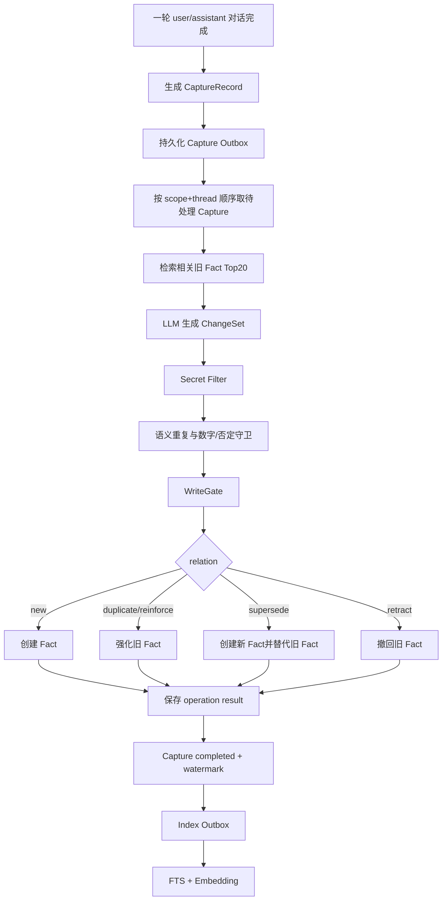
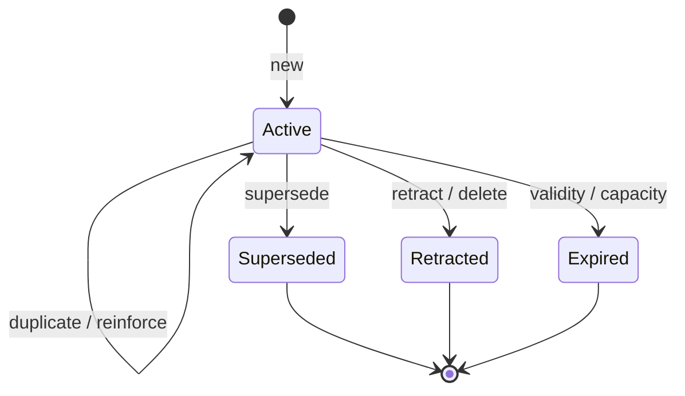
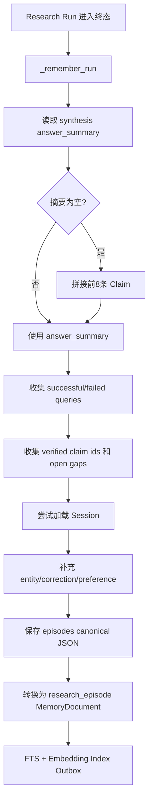

# L3 长期记忆系统：原理、实现与面试指南

> 适用项目：`deepresearchv1.2`  
> 整理日期：2026-08-23  
> 目标：理解当前 L3 的真实代码结构，并能够在 Agent Memory、LLM 应用工程和系统设计面试中讲清长期记忆的写入、更新、检索、作用域、可靠性与生命周期。

---

## 0. 先给出面试结论

本项目的 L3 不是“把聊天记录放进向量数据库”，而是由两个长期记忆平面组成：

1. **Atomic Fact Memory**：保存能够跨 Session 独立复用的用户偏好、约束、纠正、画像和项目决策；
2. **Research Episode Memory**：保存一次 Deep Research Run 的研究主题、最终摘要、查询经验、未解决 Gap 和报告路径。

两个平面共享一套自研检索与可靠性基础设施：

```text
SQLite canonical data
FTS5 lexical index
multilingual dense embedding
scoped NumPy cosine index
capture/index outbox
revision/history/audit
```

一句话版本：

> L3 用原子 Fact 记住“未来应该知道或遵守什么”，用 Research Episode 记住“过去一次研究做过什么、得到什么、还缺什么”；正文由 SQLite 持有，FTS 和向量只是可重建的检索投影。

---

## 1. L3 在完整记忆架构中的位置

```text
L0  LangGraph 执行持久化
    checkpoint、pause/resume、节点重试

L1  单次 Research Run 工作状态
    Plan、Task、Claim、Evidence、Gap、Worker 状态

L2  当前 Session 会话连续性
    热消息、摘要、意图、纠正、偏好、澄清状态

L2.5 历史 Conversation Segment
    从 L2 淘汰出的可检索压缩片段

L3  跨 Session 长期记忆                         ← 本文重点
    Atomic Fact + Research Episode
```

### 1.1 L3 解决的问题

当用户打开新的 Session 时，系统仍然需要知道：

- 用户长期偏好什么语言和输出格式；
- 用户曾经明确设置过哪些约束；
- 某个项目已经做过哪些决策；
- 上一次相似研究用了哪些查询；
- 哪些查询失败过；
- 上次研究还留下了什么 Gap；
- 完整报告保存在哪里。

### 1.2 L3 不负责什么

L3 不等于：

- 当前聊天窗口的完整上下文；
- LangGraph 的恢复状态；
- Worker 的完整思维链；
- 外部知识库 RAG；
- 绝对真实的世界知识库；
- 所有原始聊天记录的全文搜索系统。

---

## 2. L3 到底有哪些内容

| 类别 | 对象 | 粒度 | 是否属于真正记忆 |
|---|---|---:|---|
| 事实记忆 | `MemoryFact` | 一条原子事实 | 是 |
| 研究经历 | `MemoryEpisode` | 一次 Research Run | 是 |
| 文档投影 | `MemoryDocument` | Episode/Segment 的检索表示 | 派生表示 |
| 检索索引 | FTS、Embedding、NumPy Cache | 向量/关键词 | 否，可重建 |
| 版本系统 | History、Audit、Manifest | 变更事件 | 支撑数据 |
| 可靠队列 | Capture Outbox、Index Outbox | 待处理任务 | 支撑数据 |
| 使用统计 | Retrieval Count | 检索行为 | 支撑数据 |

完整结构：

```text
L3 Long-term Memory
├── Atomic Fact Plane
│   ├── preference
│   ├── profile
│   ├── constraint
│   ├── correction
│   └── project_decision
│
├── Research Episode Plane
│   ├── research brief
│   ├── final summary
│   ├── successful/failed queries
│   ├── verified claim ids
│   ├── open gaps
│   └── report pointer
│
├── Retrieval Projection
│   ├── FTS5
│   ├── multilingual embedding
│   ├── SQLite Float32 BLOB
│   └── scoped NumPy exact cosine
│
└── Reliability Plane
    ├── capture outbox
    ├── index outbox
    ├── watermark
    ├── applied-operation log
    ├── revision history
    └── audit log
```

---

## 3. Fact 与 Episode 的核心区别

| 维度 | Atomic Fact | Research Episode |
|---|---|---|
| 回答的问题 | 未来应该记住什么 | 过去一次研究发生了什么 |
| 粒度 | 一条可独立使用的事实 | 一次完整 Run 的经验包 |
| 示例 | 用户要求报告附来源 | 上次研究用了哪些查询、留下哪些 Gap |
| 来源 | 手动写入或用户对话抽取 | Research Run 结束后生成 |
| LLM | LLM 提出候选关系 | 使用上游 Synthesizer 摘要，不额外抽取 Fact |
| CRUD | Create/Get/Update/Delete/Reinforce | 当前主要是 Upsert/Get/Search |
| Revision | 有 | 无 |
| History/Audit | 有 | 无完整版本历史 |
| 生命周期 | 过期、容量淘汰、替代、撤回 | 当前没有完整生命周期 |
| 检索评分 | 词法、语义、置信度、时间、强化 | 词法、语义、时间 |

最重要的设计原则：

> 不把一次研究过程拆成大量用户 Fact，也不把用户永久约束只埋在某个 Episode 中。

---

## 4. L3 的作用域模型

### 4.1 `MemoryScope`

```python
class MemoryScope:
    scope_type: USER | PROJECT | AGENT
    user_id: str
    project_id: str
    agent_name: str | None
```

Scope Key：

```text
{scope_type}:{user_id}:{project_id}:{agent_name-or--}
```

### 4.2 User Scope

```text
user:alice:project-a:-
```

适合：

- 用户偏好中文；
- 用户喜欢简洁回答；
- 用户是数据库工程师；
- 用户要求引用可点击。

### 4.3 Project Scope

```text
project:alice:project-a:-
```

适合：

- 当前项目统一使用 SQLite；
- 当前项目只分析国内市场；
- 项目报告必须包含审计表。

当前 Project Scope 仍包含 `user_id`，所以它是“某用户在某项目里的记忆”，不是跨用户共享的团队知识库。

### 4.4 Agent Scope

```text
agent:alice:project-a:planner
```

底层模型和检索授权支持 Agent Scope，但当前自动 Fact Extractor 只会产生 user/project 候选。Agent Scope 主要是预留和手动能力。

### 4.5 检索时的授权集合

普通 user/project 查询会联合检索：

```text
当前 User Scope
+ 当前 Project Scope
```

当查询请求本身是 Agent Scope 时，再加入对应 Agent Scope。

这意味着 Project 约束能够与 User 偏好一起提供给 Planner，但不会跨 user/project 边界搜索。

---

## 5. Atomic Fact 数据模型

```python
class MemoryFact:
    fact_id: str
    scope: MemoryScope
    content: str
    content_hash: str
    category: str
    confidence: float
    status: FactStatus
    source_type: SourceType
    source_episode_id: str | None
    source_thread_id: str | None
    evidence_message_ids: list[str]
    expected_valid_days: int | None
    last_confirmed_at: str
    confirmation_count: int
    superseded_by: str | None
    consolidated_from: list[str]
    revision: int
    metadata: dict
    created_at: str
    updated_at: str
```

### 5.1 身份与正文

| 字段 | 说明 |
|---|---|
| `fact_id` | Fact 唯一 ID |
| `scope` | 身份和授权边界 |
| `content` | 原子事实正文，最长 4000 字符 |
| `content_hash` | 规范化正文 SHA-256，用于精确去重 |
| `category` | preference/profile/constraint 等分类 |

### 5.2 可信度与确认

| 字段 | 说明 |
|---|---|
| `confidence` | 写入置信度，范围 0～1 |
| `confirmation_count` | 被重复确认的次数 |
| `last_confirmed_at` | 最近一次确认时间 |

`confidence` 不是外部世界真值概率，而是系统对“这是否值得作为长期记忆”的写入置信度。

### 5.3 来源与证据

| 字段 | 说明 |
|---|---|
| `source_type` | manual/conversation/research_episode/consolidation |
| `source_thread_id` | 来自哪个 Session |
| `source_episode_id` | 来自哪个 Episode |
| `evidence_message_ids` | 支撑 Fact 的用户消息 ID |

当前自动主链主要创建 `conversation` Fact；`research_episode` 和 `consolidation` 是数据模型支持但尚未形成完整自动流程的来源类型。

### 5.4 状态与版本

| 字段 | 说明 |
|---|---|
| `status` | active/superseded/retracted/expired |
| `superseded_by` | 旧 Fact 被哪条新 Fact 替代 |
| `revision` | 乐观锁版本号 |
| `expected_valid_days` | 预期有效期 |
| `consolidated_from` | 合并来源，当前主要为预留能力 |

---

## 6. 什么应该进入 Fact

### 6.1 应该保存

```text
用户偏好中文简洁回答
用户要求所有结论附带可点击来源
用户是数据库工程师
用户明确纠正：关注 TiDB，不是 TDSQL
项目决定使用 SQLite 作为 canonical store
项目禁止使用未经验证的二手来源
```

### 6.2 不应该保存

```text
你好
帮我查一下今天的新闻
助手猜测某公司明年会增长
工具返回的一段网页正文
一次性的查询问题
完整聊天记录
短暂情绪
密码、API Key、Access Token
```

判断标准：

```text
是否由用户明确表达？
是否具有未来复用价值？
是否能脱离原对话单独理解？
是否足够稳定？
是否不包含秘密和临时指令？
```

---

## 7. 自动 Fact 写入总流程



核心思想：

```text
LLM 提议
确定性代码准入
SQLite 事务提交
派生索引异步重建
```

---

## 8. Capture 阶段

### 8.1 触发时机

助手完成一轮消息写入后，如果：

```yaml
automatic_capture_enabled: true
```

系统会调用 `enqueue_turn()`。

### 8.2 Capture 输入范围

只选择与当前 `turn_id` 相同的：

```text
user message
assistant message
```

长度限制：

| Role | 最大字符数 | 用途 |
|---|---:|---|
| user | 8000 | 候选事实和唯一合法证据来源 |
| assistant | 4000 | 抽取上下文，不能作为 Fact 证据 |

### 8.3 `CaptureRecord`

```text
capture_id
scope
thread_id
turn_id
messages
signals
attempts
created_at
```

`capture_id` 根据 Scope、Thread、Turn 和消息 ID 确定性生成。重复 enqueue 使用 `INSERT OR IGNORE`，不会创建重复 Capture。

### 8.4 Signal Detection

系统检测：

```text
explicit_memory  记住、别忘、remember
preference       我喜欢、我偏好、以后请
correction       不是、改成、纠正
identity         我是、我的职业、我的项目
constraint       必须、不要、始终、只用
```

没有显式关键词时，只要存在用户内容，也会标记为：

```text
conversation_candidate
```

Signal 只是低成本提示，不直接决定是否写入。

---

## 9. LLM Fact Extractor

写入前先用用户输入检索最多 20 条相关旧 Fact，再将其与 Capture 一起提供给 LLM。

### 9.1 Extractor 输入

```text
operation_id
scope
signals
本轮 user/assistant messages
相关旧 facts
写入规则
```

### 9.2 Extractor 输出

```python
class FactCandidate:
    content: str
    category: str
    scope: "user" | "project"
    confidence: float
    relation: new | duplicate | reinforce | supersede | retract
    target_id: str | None
    evidence_message_ids: list[str]
    expected_valid_days: int | None
    metadata: dict
```

所有候选组成一个：

```python
ChangeSet(
    operation_id,
    candidates,
    extractor_model,
    created_at,
)
```

### 9.3 Extractor Prompt 的重要约束

LLM 被要求：

- 只抽取用户明确表达的持久信息；
- 不把助手主张、研究结果、猜测、工具输出变成用户 Fact；
- 不保存一次性问题、问候、完整对话；
- 不保存秘密、密码、API Key、Access Token；
- 每个候选必须引用本轮用户消息；
- Project Scope 只用于稳定项目决策；
- 用户纠正旧事实时使用 supersede；
- 用户明确撤回时才使用 retract。

---

## 10. Secret Filter 与输入清洗

候选正文会：

```text
去首尾空白
合并连续空格
截断到 4000 字符
```

以下内容会被过滤：

```text
api key
apikey
password
密码
access token
sk-...
ghp_...
github_pat_...
```

这是基础 Secret Filter，不是完整 DLP。它目前不能保证识别：

- 所有云厂商密钥格式；
- 私钥和证书；
- 身份证、手机号等 PII；
- 被空格、编码或分段混淆的秘密。

---

## 11. WriteGate：确定性准入

LLM 只能提出候选，最终写入必须通过确定性检查。

### 11.1 置信度门槛

默认：

```yaml
fact_confidence_threshold: 0.75
```

低于阈值：

```text
skipped = low_confidence
```

### 11.2 用户证据门槛

合法 Evidence 必须是：

```text
本次 Capture 中 role=user 的真实 message_id
```

如果候选只引用助手消息、工具结果、其他 Turn 或不存在的消息：

```text
skipped = unsupported
```

这条规则阻止“助手说用户住在火星”被写成用户画像。

### 11.3 Scope 门槛

如果候选引用的目标 Fact 不属于候选 Scope：

```text
skipped = scope_mismatch
```

### 11.4 Target 门槛

需要旧 Fact 的关系如果找不到有效目标：

```text
duplicate/reinforce → missing_target
retract             → missing_target
```

`supersede` 找不到旧目标时，受支持的新 Fact 仍然可以创建，但会记录：

```text
missing_supersede_target
```

这样不会因为关系判断失败丢掉一条本身有用户证据的新信息。

---

## 12. Fact 关系状态机



普通检索只返回 `active`。

### 12.1 New

第一次表达：

```text
以后所有回答使用中文。
```

结果：

```text
status = active
revision = 1
confirmation_count = 1
```

### 12.2 Duplicate

规范化正文和 Scope 完全相同：

```text
不创建新 Fact
→ 强化已有 Fact
```

### 12.3 Reinforce

用户再次确认：

```text
以后还是继续用中文。
```

结果：

```text
confirmation_count += 1
last_confirmed_at = now
revision += 1
合并 evidence_message_ids
提高 confidence
```

强化置信度：

```text
new_confidence
= 1 - (1 - old_confidence) × (1 - observed_confidence × 0.5)
```

### 12.4 Supersede

旧 Fact：

```text
用户偏好英文报告
```

用户纠正：

```text
以后改成中文报告
```

结果：

```text
创建新 active Fact
旧 Fact.status = superseded
旧 Fact.superseded_by = 新 fact_id
```

### 12.5 Retract

用户明确撤回：

```text
不用再记住我的语言偏好。
```

结果：

```text
status = retracted
revision += 1
```

### 12.6 Expire

Fact 超过有效期或 Scope 容量时：

```text
status = expired
```

这些状态都是软状态，不会直接物理删除正文和历史。

---

## 13. 三层去重与冲突保护

### 13.1 Content Hash 精确去重

正文经过规范化后计算 SHA-256：

```text
casefold
trim
合并空白
→ SHA-256
```

相同 Scope 下，active Fact 的 `content_hash` 具有唯一约束。

### 13.2 LLM Relation

Extractor 根据旧 Fact 决定：

```text
new / duplicate / reinforce / supersede / retract
```

### 13.3 Semantic Dedup

真实 Embedding 可用时：

```text
检索候选正文最相似的旧 Fact
semantic >= 0.92
category 相同
数字/否定兼容
→ relation = duplicate
```

哈希降级模式不会执行自动语义去重。

### 13.4 数字保护

以下内容不会错误合并：

```text
预算上限是 100 元
预算上限是 200 元
```

### 13.5 否定保护

以下内容不会错误合并：

```text
允许保存完整报告
不要保存完整报告
```

当前数字规则能够保护数字形式的日期差异，但还不是完整的时间解析和单位语义系统。

---

## 14. Fact CRUD、Revision 与审计

### 14.1 Create

手动 Fact：

- `confidence=1.0`；
- `source_type=manual`；
- 不要求 Capture Evidence；
- 默认不参加自动时间过期。

如果相同 Scope 下已存在同 Hash active Fact，会强化旧 Fact。

### 14.2 Get/List/Search

```text
get(fact_id)
list_facts(scope, status)
search(query, scope, limit)
```

普通 Search 只召回 active Fact。

### 14.3 Update

更新必须提交：

```text
expected_revision
```

事务语义：

```sql
UPDATE memory_facts
SET ..., revision = revision + 1
WHERE fact_id = ?
  AND revision = expected_revision
```

版本不匹配抛出：

```text
RevisionConflictError
```

### 14.4 Delete

Delete 是软删除：

```text
status = retracted
revision += 1
```

支持可选 `expected_revision`。

### 14.5 History

每次创建、更新、强化、替代、撤回、过期都会保存：

```text
fact_id
scope_key
revision
event_type
snapshot_json
operation_id
actor
created_at
```

History 回答“这条 Fact 每个版本是什么”。

### 14.6 Audit

Audit 保存：

```text
operation_id
action
fact_id
scope_key
details
created_at
```

Audit 回答“谁通过什么操作修改了哪条 Fact”。

### 14.7 Manifest

每次 Scope 内 Fact 发生变化时，`memory_manifests.revision` 增加。它用于表示 Scope 的整体版本，也可帮助向量缓存判断是否失效。

---

## 15. Fact 生命周期

### 15.1 时间过期

非手动 Fact 使用：

```text
expected_valid_days
```

未设置时使用：

```yaml
default_fact_valid_days: 365
```

判断：

```text
now - last_confirmed_at > valid_days
→ expired
```

Manual Fact 被排除在默认自动过期之外。

### 15.2 Reinforcement 延长有效性

Fact 被再次确认时：

```text
last_confirmed_at = now
```

因此会自然延后过期时间。

### 15.3 Scope 容量

默认：

```yaml
max_facts_per_scope: 500
```

容量保留顺序：

```text
confidence DESC
confirmation_count DESC
updated_at DESC
```

超出容量的 active Fact 标记为 expired。

### 15.4 Retrieval Usage

命中 Fact 后记录：

```text
retrieval_count
last_retrieved_at
```

当前 Usage 主要用于统计，没有直接进入容量和过期公式。

---

## 16. Research Episode 数据模型

```python
class MemoryEpisode:
    episode_id: str
    user_id: str
    project_id: str
    session_id: str
    run_id: str
    research_brief: str
    status: str
    summary: str
    verified_claim_ids: list[str]
    open_gaps: list[str]
    successful_queries: list[str]
    failed_queries: list[str]
    entities: list[str]
    user_corrections: list[str]
    preferences: dict
    report_path: str | None
    created_at: str
```

### 16.1 身份与关联

| 字段 | 说明 |
|---|---|
| `episode_id` | Episode 唯一标识 |
| `user_id/project_id` | 长期记忆 Scope |
| `session_id` | 来源 Session |
| `run_id` | 来源 Research Run |

### 16.2 研究结果

| 字段 | 说明 |
|---|---|
| `research_brief` | 研究问题 |
| `status` | Run 终态 |
| `summary` | 最终研究摘要 |
| `verified_claim_ids` | 本次 Run 产生的 Claim ID |
| `open_gaps` | 尚未解决的问题 |
| `report_path` | 完整报告路径 |

### 16.3 研究经验

| 字段 | 说明 |
|---|---|
| `successful_queries` | 有结果且无错误的搜索查询 |
| `failed_queries` | 报错或无结果的搜索查询 |
| `entities` | Session 活跃实体快照 |
| `user_corrections` | Session 纠正快照 |
| `preferences` | Session 偏好快照 |

---

## 17. Episode 写入流程



### 17.1 保存条件

必须：

- 请求包含 `session_id`；
- Run 已离开 queued/running；
- 进入最终记忆沉淀阶段。

失败、部分完成或取消等终态也可能形成 Episode，这样能够保留失败经验。

### 17.2 Summary 回退

优先：

```text
synthesis_decision.answer_summary
```

没有时：

```text
前 8 条 Claim 文本拼接
```

仍为空时：

```text
本次研究未形成可复用结论。
```

### 17.3 Query 成败判断

成功：

```text
有 query
AND results 非空
AND 没有 error
```

失败：

```text
存在 error
OR results 为空
```

当前判断的是“搜索有没有返回结果”，不是结果是否真正高质量、是否最终被引用。

---

## 18. Episode 的双重表示

### 18.1 Canonical Episode

SQLite `episodes` 保存：

```text
episode_id
user_id
project_id
created_at
data JSON
```

### 18.2 Search Projection

Episode 同时转换成：

```text
MemoryDocument.document_type = research_episode
```

检索正文由以下内容拼接：

```text
research_brief
summary
open_gaps
successful_queries
failed_queries
```

完整 Episode JSON 放在 `metadata`。

### 18.3 旧数据迁移

系统启动时会读取旧 `episodes` 数据并回填新的文档索引，默认最多处理最近 5000 条。

### 18.4 Episode 当前缺失能力

Episode 目前没有 Fact 同级的：

- Revision/CAS；
- History；
- Audit；
- active/superseded/retracted 状态机；
- 自动过期；
- 容量淘汰；
- 删除 API；
- Confirmation Count。

因此 Episode 当前成熟度低于 Fact。

---

## 19. Canonical Store 与派生索引

### 19.1 Canonical Data

```text
memory_facts
episodes
memory_documents metadata/content
memory_history
memory_audit
```

### 19.2 Derived Projection

```text
memory_fts
memory_embeddings
memory_document_fts
memory_document_embeddings
NumPy per-scope cache
```

### 19.3 设计不变量

```text
索引可以删除后重建
Canonical Fact/Episode 不能依赖索引才能恢复
Embedding 失败不回滚正文
模型升级不修改事实本身
```

这是一种 canonical write model + derived read projection 的设计，可以视为轻量 CQRS 思路，但当前不是完整事件溯源系统。

---

## 20. Embedding 与向量索引

### 20.1 默认模型

```text
intfloat/multilingual-e5-small
384 dimensions
query prefix: query:
document prefix: passage:
```

### 20.2 向量存储

```text
normalized float32 vector
→ pack as little-endian Float32 BLOB
→ SQLite memory_embeddings
```

记录：

```text
model
dimensions
vector
content_hash
indexed_at
```

### 20.3 查询方式

按授权 Scope 加载匹配模型和维度的向量，构建 NumPy Matrix：

```text
query_vector @ document_matrix.T
```

向量已归一化，因此点积等价于余弦相似度。

### 20.4 缓存

Cache Key 包含：

```text
document type
scope keys
embedding model
dimensions
```

Scope Manifest 或索引时间变化时重建缓存。

### 20.5 为什么暂时不用向量数据库

单 Scope 默认最多约 500 个 active Fact，Episode 数量也处于中小规模。NumPy 精确扫描：

- 实现简单；
- 结果精确；
- 无额外服务；
- 数据仍完全掌握在 SQLite。

当单 Scope 达到数万至数十万条后，才需要评估 HNSW、FAISS 或向量数据库。

### 20.6 降级模式

如果 `sentence-transformers` 或模型不可用：

```text
deterministic hash embedding
embedding_degraded = true
matched_by = hash_vector_fallback
```

哈希向量只能提供词面近似，不能宣称为真正语义检索。

---

## 21. 混合检索算法

### 21.1 候选召回

```text
FTS5 Top 50
+
Dense Vector Top 50
→ candidate union
```

候选并集后再计算最终评分，避免只走语义或只走关键词。

### 21.2 Fact Score

```text
total =
0.35 × lexical
+ 0.35 × semantic
+ 0.15 × confidence
+ 0.10 × recency
+ 0.05 × reinforcement
```

其中：

```text
reinforcement = min(1, confirmation_count / 5)
```

准入要求：

```text
lexical > 0
OR semantic >= threshold
```

防止一条高置信度、很新但与 Query 无关的 Fact 进入结果。

### 21.3 Episode/Document Score

```text
total =
0.40 × semantic
+ 0.40 × lexical
+ 0.20 × recency
```

Episode 没有 Fact 的 confidence 和 confirmation。

### 21.4 语义阈值

```text
真实 Embedding：0.25
Hash Fallback：0.18
```

### 21.5 Score Explanation

Fact 结果返回：

```text
lexical
semantic
confidence
recency
reinforcement
total
matched_by
explanation
```

这使检索不是只有一个黑盒分数。

---

## 22. 跨类型融合与角色注入

当前 `relevant_episodes()` 名称是历史遗留，实际融合：

```text
Atomic Fact
Research Episode
Conversation Segment
```

Segment 属于 L2.5，但通过同一文档检索基础设施参与上下文构建。

### 22.1 Clarifier

默认：

```yaml
fact_top_k_clarifier: 3
```

重点使用：

- 用户纠正；
- 用户偏好；
- 跨 Session 相关实体；
- 相关历史研究摘要。

### 22.2 Planner

默认：

```yaml
fact_top_k_planner: 5
```

重点使用：

- 用户和项目约束；
- 历史成功查询；
- 历史失败查询；
- Open Gaps；
- 相关 Episode；
- 研究偏好。

### 22.3 Worker

Worker 从 Planner Packet 中再按任务关键词筛选，最多保留约 3 条任务相关历史，并结合当前 Claim 和 Gap。

Worker 不直接访问整个长期记忆数据库。

### 22.4 Synthesizer 与 Writer

它们主要读取当前 Run 的 Claim、Evidence、Conflict 和 Gap，不直接检索 L3。Run 结束后再由 `_remember_run()` 沉淀新 Episode。

---

## 23. Outbox、幂等性与 Watermark

### 23.1 Capture Outbox

对话完成后先持久化 Capture，不要求在消息保存事务里同步完成 LLM 抽取。

失败重试：

```text
delay = min(3600, 2^attempts) seconds
```

### 23.2 Thread 内顺序

同一个：

```text
scope_key + thread_id
```

只处理最早 pending Capture，保证旧事实先于后续纠正进入状态机。

代价是严格队首阻塞：最早 Capture 持续失败时，后续 Capture 也会等待。

### 23.3 Operation Idempotency

`operation_id` 根据 Capture 确定性生成。结果保存在：

```text
memory_applied_operations
```

重复执行直接返回原 `ApplyResult`，不会重复写 Fact。

### 23.4 Watermark

成功后记录：

```text
scope_key
thread_id
last_capture_id
last_turn_id
updated_at
```

Watermark 在 ChangeSet 和 operation result 成功提交后推进。

### 23.5 Index Outbox

Fact/Episode 正文提交后，索引任务进入：

```text
memory_index_outbox
memory_document_index_outbox
```

索引失败指数退避，最大约 300 秒。Canonical 数据不回滚。

### 23.6 模型迁移

系统比较已保存 Embedding 的 `model`。模型不一致或索引缺失时，自动重新加入 Index Outbox。

---

## 24. 完整流转示例

### Turn 1：创建两个 Fact

用户：

```text
以后所有研究报告都用中文，并附可点击来源。
```

系统：

```text
Capture
→ 检索旧 Fact
→ LLM ChangeSet
  1. 用户偏好中文研究报告
  2. 用户要求报告附可点击来源
→ WriteGate 验证用户证据
→ 创建两个 active Fact
→ FTS/Embedding
```

### Turn 2：强化和新增

用户：

```text
还是保持中文，但来源必须是 2025 年后的。
```

可能结果：

```text
中文偏好 → reinforce
2025 年后来源 → new constraint
```

### Turn 3：替代旧约束

用户：

```text
来源时间改成 2024 年以后。
```

可能结果：

```text
创建新 Fact：来源必须是 2024 年以后
旧 Fact：2025 年以后 → superseded
```

### Research Run 完成：生成 Episode

```text
Research Episode
├── 本次研究问题
├── 最终摘要
├── verified claim ids
├── 成功查询
├── 失败查询
├── 未解决 Gap
└── report.md 路径
```

### 新 Session 再次研究

```text
Planner MemoryPacket
├── Fact：中文报告
├── Fact：来源附链接
├── Fact：只用 2024 年后来源
└── Episode：上次研究摘要、查询经验、Gap
```

---

## 25. L3 中哪些地方使用 LLM

### 25.1 使用 LLM

1. 从 Conversation Capture 中提出 FactCandidate；
2. 判断 new/reinforce/supersede/retract 等关系；
3. 上游 Synthesizer 生成 Episode 的 `answer_summary`。

### 25.2 使用 Embedding Model

1. Fact Dense Retrieval；
2. Episode/Segment Dense Retrieval；
3. Semantic Duplicate Detection。

Embedding 模型不是对话 LLM。

### 25.3 确定性代码负责

- Scope；
- Evidence 校验；
- Confidence Gate；
- Secret Pattern；
- Hash 去重；
- 数字/否定冲突保护；
- Revision/CAS；
- 事务和状态机；
- Outbox/Watermark；
- 过期和容量；
- 检索评分公式。

设计原则：

> LLM 负责语义提议，代码负责安全边界、状态一致性和最终提交。

---

## 26. 安全与可信度边界

### 26.1 已有措施

- 自动 Fact 必须有本轮用户消息证据；
- Assistant/Tool 内容不能作为 Evidence；
- Secret Filter；
- Scope 验证；
- 低置信度拒绝；
- 软删除和审计；
- Worker 不直接读取全部长期记忆；
- 研究结果不会自动批量提升成用户 Fact。

### 26.2 Fact 不是世界真相

Fact 表示：

> 用户明确说过什么，或者项目明确决定过什么。

例如用户说“我是数据库专家”，可以作为用户 Profile，但不代表系统已经外部验证其职业身份。

### 26.3 Episode 也不是事实数据库

Episode 的 Summary 来自一次研究综合结果。它可以帮助下次规划，但不能绕过当前 Run 的 Evidence/Citation Gate 直接作为新结论依据。

### 26.4 当前缺口

- Secret Filter 不是完整 DLP；
- 没有字段级 PII 脱敏；
- 没有完整用户级物理删除；
- Project Scope 不是团队 RBAC；
- Episode 没有删除审计；
- SQLite 静态数据没有专门加密层。

---

## 27. 一致性和故障场景

| 场景 | 当前行为 | 数据是否丢失 |
|---|---|---|
| Fact Extractor 失败 | Capture 保持 pending，指数退避 | 否 |
| WriteGate 拒绝候选 | Capture 完成，记录 skipped | 否，不写不合格 Fact |
| ChangeSet 重复执行 | 返回已保存 ApplyResult | 不重复写 |
| Fact 主事务失败 | 整个 ChangeSet 回滚，Watermark 不推进 | 否 |
| Embedding 失败 | Fact/Episode 保留，Index Outbox 重试 | 否 |
| FTS 不可用 | 降级 overlap/vector | 否 |
| Sentence Transformer 不可用 | 显式 Hash Fallback | 否，但语义质量下降 |
| 模型版本变化 | 旧记录进入重建队列 | 否 |
| Revision 不匹配 | 抛出冲突，不覆盖新版本 | 否 |
| 最早 Capture 持续失败 | 后续同 Thread Capture 等待 | 不丢，但形成队首阻塞 |
| Episode Session 补充失败 | 仍保存基础 Episode | 否，缺少 entity/preference 快照 |

### 27.1 跨 Fact 与索引的一致性

Fact 主事务和 Embedding 不在同一事务中。这是有意设计：

```text
强一致：Fact、History、Audit、Operation、Watermark
最终一致：FTS/Embedding Projection
```

### 27.2 Episode 一致性

Episode 先写 `episodes`，再 Upsert `MemoryDocument`。两个操作不是同一个事务；失败时可能出现 Episode 已保存但搜索投影暂时缺失。启动回填和 Index Outbox 用于恢复。

---

## 28. 性能与规模边界

### 28.1 当前适用规模

Fact 默认单 Scope 500 条，NumPy Exact Cosine 足够简单且准确。

### 28.2 主要成本

写入：

```text
一次相关旧 Fact 检索
+ 一次 LLM Fact Extraction
+ SQLite Transaction
+ Embedding Batch
```

查询：

```text
FTS5
+ Query Embedding
+ Scope Matrix Dot Product
+ Hybrid Ranking
```

### 28.3 当前瓶颈

- Sentence Transformer 首次加载；
- 每 Scope 向量数量增长后的 Matrix 扫描；
- Capture LLM 延迟；
- 同 Thread 队首阻塞；
- Episode 数量无限增长；
- 每次 Sync 只处理有界 Outbox Batch。

### 28.4 ANN 切换条件

当出现以下情况时再考虑 HNSW/FAISS：

- 单 Scope 数万条以上；
- 向量矩阵内存明显增大；
- P95 检索延迟不可接受；
- 多实例重复维护同一 Scope Matrix；
- 需要 metadata filter + ANN 的统一执行计划。

---

## 29. 可观测性与测试

### 29.1 当前统计

`MemoryStats` 包括：

```text
active_facts
inactive_facts
pending_captures
pending_indexes
history_events
indexed_documents
pending_document_indexes
embedding_model
embedding_dimensions
embedding_degraded
embedding_error
```

### 29.2 当前测试覆盖

- Fact Create/Duplicate/Reinforce；
- Update Revision Conflict；
- Soft Delete；
- History 顺序；
- User/Project Scope 隔离；
- FTS 与混合检索；
- Assistant Evidence 被 WriteGate 拒绝；
- Capture Outbox 与 Watermark；
- 跨语言语义召回；
- Episode/Document 向量召回；
- 数字和否定冲突保护；
- Conversation Segment 与原文归档。

### 29.3 建议增加指标

```text
fact_admission_rate
fact_rejection_by_reason
semantic_dedup_rate
supersede_accuracy
capture_retry_count
capture_head_of_line_delay
index_backlog_age
episode_retrieval_hit_rate
memory_injection_usefulness
stale_fact_answer_rate
```

### 29.4 如何评测长期记忆

需要拆开测：

1. **Write Quality**：应该记的是否写入，不该记的是否拒绝；
2. **Update Quality**：纠正是否正确 supersede，撤回是否正确 retract；
3. **Retrieval Quality**：目标 Fact/Episode 是否在 Top-K；
4. **Reading Quality**：召回后 Agent 是否正确使用；
5. **Temporal Quality**：新旧事实是否处理正确；
6. **Unknown Rejection**：没有记忆时是否拒绝编造；
7. **Privacy**：秘密、PII 和删除请求是否被正确处理。

---

## 30. 优点、局限与演进路线

### 30.1 当前优点

1. Fact 与 Episode 分层，不把所有内容都当向量文档；
2. LLM 提议、确定性 WriteGate 提交；
3. 自动 Fact 必须引用用户消息；
4. 支持 Scope、CRUD、Revision、History、Audit；
5. 支持 Reinforce/Supersede/Retract/Expire；
6. Hash、LLM Relation、Semantic Guard 三层去重；
7. SQLite canonical，索引可重建；
8. Outbox、Idempotency、Watermark 提高可靠性；
9. FTS + Dense 混合检索；
10. Embedding 降级状态显式可见；
11. 完全自研，不依赖 Mem0 SDK/Cloud。

### 30.2 当前局限

1. Episode 没有完整 Revision、History、删除和生命周期；
2. Fact Extractor 仍可能分类或关系判断错误；
3. Secret Filter 不是完整 DLP；
4. 自动 Capture 只处理当前表层 Turn；
5. 用户输入超过 8000 字符的尾部不参与抽取；
6. Evidence 只有消息 ID，没有字段级原文 Span；
7. Episode Query 成败不代表真正贡献度；
8. Episode 数量没有容量控制；
9. NumPy 精确扫描不适合超大 Scope；
10. 没有 Cross-Encoder Reranker、实体图谱和多跳推理；
11. 同 Thread Capture 有队首阻塞；
12. 没有完整用户级物理忘记流程；
13. Project Scope 还不是团队共享知识库；
14. 跨 Fact/Episode/Segment 的分数没有统一离线标定；
15. Consolidation 数据模型已预留，但后台合并任务尚未实现。

### 30.3 P0：安全与一致性

1. 用户级 Forget/Delete Graph；
2. Episode Revision、History、Soft Delete；
3. PII/Secret DLP 与加密；
4. Capture Dead-letter Queue，避免永久队首阻塞；
5. Episode 与 Document Projection 的恢复状态表。

### 30.4 P1：记忆质量

1. Evidence Span 和来源快照；
2. 时间归一化与 Temporal Supersede；
3. Fact Consolidation Job；
4. Cross-Encoder Reranker；
5. Query Rewrite 和时间感知检索；
6. Episode 贡献度评分，而不是简单成功/失败查询。

### 30.5 P2：规模化

1. ANN Vector Index；
2. 团队 Project Scope 和 RBAC；
3. 多实例共享索引；
4. Memory Evaluation Dashboard；
5. 冷热分层和归档存储；
6. Entity Link 与可控多跳推理。

---

## 31. 与常见系统的比较

### 31.1 与简单向量聊天记录

```text
简单方案：每条消息切块 → Embedding → Top-K
当前方案：原子 Fact 状态机 + Research Episode + 混合检索
```

当前方案多了：

- 原子事实抽取；
- Scope；
- Evidence Gate；
- Revision；
- Supersede/Retract；
- 生命周期；
- Audit；
- 研究过程经验。

### 31.2 与 RAG

```text
RAG：从外部知识文档检索证据
L3：从用户历史和研究历史检索个性化上下文
```

L3 不能替代当前研究的网页 Evidence 和 Citation Gate。

### 31.3 与 Mem0

借鉴：

- 原子事实；
- user/project/agent addressing；
- new/reinforce/update/delete relation；
- 语义检索和 History。

自主改造：

- SQLite 是唯一 canonical store；
- 软删除和 Revision 优先；
- Evidence 只允许用户消息；
- Capture/Index Outbox；
- Watermark 和 Operation Idempotency；
- 数字/否定冲突保护；
- 不调用 Mem0 SDK/Cloud/REST。

### 31.4 与知识图谱

当前 Fact 是原子文本，没有显式实体节点、关系边和多跳查询。它适合中小规模用户记忆，但不能代替完整知识图谱。

### 31.5 与 L2

```text
L2：当前 Session 的连续性，可以包含临时和未验证内容
L3：跨 Session 的持久记忆，需要更严格准入和生命周期
```

---

## 32. 面试 60 秒回答

> 我的 L3 不是简单向量库，而是 Fact 和 Episode 两个平面。Fact 保存跨 Session 可独立使用的用户偏好、约束、纠正和项目决策，支持 user/project/agent Scope、CRUD、Revision、History、Audit、Reinforce、Supersede、Retract 和 Expire；Episode 保存一次 Research Run 的研究摘要、成功失败查询、Claim ID、Gap 和报告路径。写入时先把完成的 Turn 放入 Capture Outbox，检索相关旧 Fact，再由 LLM 生成 ChangeSet，最后通过用户消息 Evidence、Confidence、Scope、Secret Filter、Hash 和语义冲突守卫确定性准入。SQLite 是 canonical store，FTS 和 Embedding 是 Index Outbox 构建的可重建 Projection；检索使用 FTS Top50 与 Dense Top50 候选融合，并按 Clarifier、Planner、Worker 做角色投影。当前主要不足是 Episode 生命周期不完整、同 Thread Capture 可能队首阻塞、Project Scope 还不是团队共享，以及向量层仍是中小规模精确扫描。

---

## 33. 面试 3 分钟回答框架

### 第一步：定义两个长期记忆对象

```text
Fact：稳定、原子、可更新
Episode：一次研究的过程和结果经验
```

### 第二步：讲写入管线

```text
Turn → Capture Outbox → Existing Recall
→ LLM ChangeSet → WriteGate → Transaction
→ Index Outbox
```

### 第三步：讲状态机

```text
new / reinforce / supersede / retract / expire
```

### 第四步：讲检索

```text
FTS50 + Dense50
→ Hybrid Score
→ Scope Authorization
→ Role Projection
```

### 第五步：讲可靠性

```text
Operation Idempotency
Watermark
Revision/CAS
Canonical vs Projection
Retry/Backoff
```

### 第六步：主动说局限

```text
Episode 生命周期
DLQ/队首阻塞
完整 Forget
Temporal Memory
ANN/Reranker
团队 RBAC
```

---

## 34. 高频面试题与参考答案

### Q1：为什么需要 Fact 和 Episode 两种类型？

Fact 表达未来可独立使用的稳定信息，Episode 表达一次研究的整体经历。如果只用 Fact，会丢失查询和 Gap 等过程经验；如果只用 Episode，用户约束会埋在大对象里，难以更新和审计。

### Q2：为什么不能直接让 LLM 写数据库？

LLM 适合语义抽取和关系提议，但不适合作为安全和一致性边界。最终必须由代码验证 Evidence、Scope、Confidence、秘密、Revision 和状态关系，并在事务中提交。

### Q3：怎么防止助手幻觉污染长期记忆？

自动 Fact 必须引用本次 Capture 中真实存在的 user message ID。Assistant 内容只能作为上下文，不能作为 Evidence。研究结果保存为 Episode，不自动批量提升成用户 Fact。

### Q4：为什么需要 Supersede，而不是直接 Update？

用户纠正代表新旧事实之间的时间关系。创建新 Fact 并把旧 Fact 标记 superseded，可以保留历史、来源和审计；直接覆盖会丢失演变过程。

### Q5：怎么处理重复事实？

先做 Scope 内 SHA-256 精确去重，再使用 LLM relation，真实 Embedding 可用时增加同类别语义去重，并用数字和否定规则阻止冲突内容被合并。

### Q6：Fact 的 Confidence 是真值概率吗？

不是。它主要表示写入候选的持久价值和抽取置信度。Fact 记录用户陈述或项目决策，不代表完成外部事实验证。

### Q7：为什么 Embedding 不放在 Fact 主事务？

模型调用慢且可能失败。如果绑定主事务，会降低写入可用性。正文先提交，Embedding 通过持久 Index Outbox 最终一致构建；索引可从 canonical data 重建。

### Q8：如何保证重复消费不会重复写？

Capture ID 和 Operation ID 都是确定性的。Capture 使用 Insert-or-ignore，已应用 ChangeSet 的 `ApplyResult` 保存在 operation 表，重试直接返回旧结果。

### Q9：为什么需要 Watermark？

Watermark 表示某 Scope/Thread 已成功处理到哪个 Turn，只在 ChangeSet 完整提交后推进。它为顺序处理、恢复和审计提供边界。

### Q10：为什么同 Thread 要按顺序处理？

用户后续纠正依赖旧 Fact 已经存在。乱序可能先写“改成中文”，之后才写“偏好英文”。严格顺序保证语义状态机正确，但会产生队首阻塞，需要 DLQ 改进。

### Q11：L3 与 RAG 有什么区别？

RAG 检索外部知识证据，L3 检索用户和研究历史。L3 提供个性化上下文，不能替代当前问题的网页证据与引用。

### Q12：为什么使用混合检索？

向量擅长同义和跨语言，FTS 擅长专有名词、代码、数字和精确约束。候选并集再评分可以提高召回，同时避免单一路径缺陷。

### Q13：为什么暂时不用向量数据库？

当前单 Scope 默认约 500 个 active Fact，NumPy 精确扫描更简单、准确且无额外基础设施。只有规模和 P95 延迟证明需要时才引入 ANN。

### Q14：Episode 当前最大问题是什么？

它没有 Fact 同级的 Revision、History、删除、过期和容量控制；成功查询定义也较粗糙。下一步应补齐 Episode 生命周期和贡献度评价。

### Q15：怎样实现“忘掉我所有信息”？

需要用户级删除图：停止 Capture、删除/撤回所有 Scope Fact、清除 History 中受政策允许的数据、删除 Episode/Document/Embedding/FTS/Usage/Outbox，并同步 L2 Session、Archive、Segment 和 Redis。当前还没有完整实现。

### Q16：怎么评价长期记忆质量？

分开测 Write、Update、Retrieval、Reading、Temporal、Unknown Rejection 和 Privacy。只看最终回答准确率无法判断是写错、没召回还是读错。

### Q17：研究结论应该自动写成 Fact 吗？

默认不应该。研究结果可能受来源质量和综合误差影响，先保存在 Episode。只有经过明确政策、来源证据和独立验证的知识才考虑进入另一类可审计知识 Fact。

---

## 35. 常见错误说法

### 错误 1

> “长期记忆就是向量数据库。”

问题：向量只是检索 Projection，缺少 canonical data、更新状态机、Scope、Evidence、History 和生命周期。

### 错误 2

> “LLM 觉得重要就直接保存。”

问题：LLM 不是授权和一致性边界，需要 WriteGate。

### 错误 3

> “Fact 是已经验证的世界事实。”

问题：当前 Fact 主要是用户陈述和项目决策。

### 错误 4

> “相似度高就一定是重复。”

问题：数字、日期、单位和否定可能完全改变语义。

### 错误 5

> “Delete 就直接删除数据库记录。”

问题：当前优先软删除和审计；真正隐私删除需要单独的物理忘记流程。

### 错误 6

> “Episode 和 Fact 是一回事。”

问题：两者粒度、更新方式、可信度和用途不同。

### 错误 7

> “索引成功才算写入成功。”

问题：正文是 canonical，索引最终一致；索引故障不应导致记忆正文丢失。

---

## 36. 白板架构图

```text
                         completed turn
                               │
                               ▼
                     ┌──────────────────┐
                     │ Capture Outbox   │
                     └────────┬─────────┘
                              │ ordered by scope/thread
                              ▼
        ┌─────────────┐  ┌──────────────────┐
        │ old Fact    │◀─│ Hybrid Recall    │
        └─────────────┘  └────────┬─────────┘
                                  ▼
                         ┌──────────────────┐
                         │ LLM ChangeSet    │
                         └────────┬─────────┘
                                  ▼
                         ┌──────────────────┐
                         │ WriteGate        │
                         │ evidence/scope   │
                         │ secret/conflict  │
                         └────────┬─────────┘
                                  ▼
                   ┌─────────────────────────┐
                   │ SQLite Canonical Store  │
                   │ Fact/History/Audit/Op   │
                   └─────────────┬───────────┘
                                 │ Index Outbox
                                 ▼
               ┌────────────────────────────────┐
               │ FTS5 + Embedding + NumPy Cache │
               └───────────────┬────────────────┘
                               │
             ┌─────────────────┼─────────────────┐
             ▼                 ▼                 ▼
         Clarifier          Planner            Worker

Research Run terminal
        │
        ▼
Research Episode ───────▶ MemoryDocument ───────▶ same retrieval plane
```

讲图时强调：

```text
Fact 和 Episode 是记忆对象
FTS 和 Embedding 是可重建索引
LLM 负责提议
WriteGate 和事务负责最终一致性
```

---

## 37. 代码导航

| 位置 | 内容 |
|---|---|
| [`deepresearch/memory_system/models.py`](../deepresearch/memory_system/models.py) | Scope、Fact、Candidate、ChangeSet、Search Result |
| [`deepresearch/memory_system/extractor.py`](../deepresearch/memory_system/extractor.py) | Signal、LLM Fact 抽取、Secret Filter |
| [`deepresearch/memory_system/repository.py`](../deepresearch/memory_system/repository.py) | SQLite、CRUD、状态机、History、Outbox、Lifecycle |
| [`deepresearch/memory_system/service.py`](../deepresearch/memory_system/service.py) | Capture 编排、Semantic Guard、混合检索 |
| [`deepresearch/memory_system/embeddings.py`](../deepresearch/memory_system/embeddings.py) | E5 Provider 与 Hash Fallback |
| [`deepresearch/memory_system/vector_index.py`](../deepresearch/memory_system/vector_index.py) | Scope NumPy Exact Index |
| [`deepresearch/memory.py`](../deepresearch/memory.py) | Episode 保存、跨类型融合、角色 Packet |
| [`deepresearch/service.py`](../deepresearch/service.py) | `_remember_run()` Episode 生成 |
| [`deepresearch/schemas.py`](../deepresearch/schemas.py) | `MemoryEpisode`、`MemoryPacket` |
| [`config/runtime.yaml`](../config/runtime.yaml) | Fact、Embedding、候选数和生命周期配置 |
| [`tests/test_autonomous_memory.py`](../tests/test_autonomous_memory.py) | Fact CRUD、History、Scope、WriteGate 测试 |
| [`tests/test_memory_semantic_upgrade.py`](../tests/test_memory_semantic_upgrade.py) | 语义检索、Episode/Segment、冲突守卫测试 |

关键入口：

```text
AutonomousMemory.enqueue_turn()
AutonomousMemory.process_captures()
MemoryExtractor.extract()
MemoryRepository.apply_changeset()
MemoryRepository._apply_candidate()
AutonomousMemory.search()
AutonomousMemory.search_documents()
ResearchService._remember_run()
LayeredMemory.save_episode()
LayeredMemory.relevant_episodes()
```

---

## 38. 最终复习清单

面试前确保可以不看文档回答：

1. L3 与 L2、RAG、Checkpoint 的边界是什么？
2. 为什么需要 Fact 和 Episode 两种记忆？
3. Fact 有哪些核心字段？
4. User/Project/Agent Scope 如何隔离？
5. 一轮对话如何进入 Capture Outbox？
6. LLM Extractor 输入输出是什么？
7. WriteGate 检查哪些条件？
8. 为什么 Assistant 不能作为 Fact Evidence？
9. new/reinforce/supersede/retract/expire 如何流转？
10. 三层去重分别是什么？
11. 如何防止数字和否定冲突被误合并？
12. Revision 如何防止并发覆盖？
13. History、Audit、Manifest 分别解决什么问题？
14. Fact 如何过期和进行容量控制？
15. Episode 保存哪些研究经验？
16. Episode 与 Fact 的成熟度差异是什么？
17. 为什么 SQLite 是 canonical，Embedding 只是 Projection？
18. FTS50 + Dense50 如何融合？
19. Clarifier、Planner、Worker 分别如何使用 L3？
20. Outbox、Operation Idempotency、Watermark 如何协作？
21. 为什么同 Thread 顺序处理会产生队首阻塞？
22. Embedding 降级时系统如何保持诚实？
23. 当前安全、隐私和团队 Scope 有哪些缺口？
24. 如何评测长期记忆的 Write、Update、Retrieval 和 Reading？
25. 如果继续改，P0/P1/P2 分别做什么？

能够连贯回答这些问题，就不仅是“会做向量检索”，而是能够设计、实现和评审一个带状态、作用域、证据、生命周期与可靠性的 Agent 长期记忆系统。
