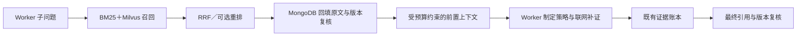

# 飞书方案的项目落地：MongoDB＋Milvus 研究资料库

更新：2026-10-19。本文区分飞书原方案、当前实现、测试结果和未完成能力。原文：[居丽叶的简历项目9：行政助手Agent，第 6—13 题](https://my.feishu.cn/wiki/CVv8wFvD8iAm0Tk1NDLc1ZwNnNe)。本次重新逐题阅读正文及有关解析、版本识别的评论；原文是项目说明，不是本项目已经实现的能力证明。

## 从原文具体学什么

| 章节 | 原文设计与边界 | 本项目适配 |
|---|---|---|
| 6 入库 | 上传字节 SHA-256 判重；解析、条款切片、批量编码；新版本全部 ready 才归档旧版；作业记 ID，失败补偿。作者明确不是严格分布式事务 | MongoDB 持久化作业和写入意图，实际写入并回读 MongoDB/Milvus；原子切换 MongoDB 单文档发布指针；失败补偿可由 reconcile 重入 |
| 7 引用有效性 | 候选过滤、原文回填复核、最终 Verify 三道状态关卡；向量 payload 可能落后于真源 | Milvus 按作用域、状态和真源允许的快照过滤；回填与前置上下文重新读取 MongoDB；最终引用门禁复核资料库快照 |
| 8 双平面 | MongoDB 管原文、版本和审计，Milvus 管可重建候选；换模型不改事实 | 原文与字符位置在 MongoDB；模型、维数和编码前缀区分索引空间；重建使用独立索引代次，完整后切换索引指针 |
| 9 混合召回 | BM25 Top20、向量 Top40，RRF k=60；不同打分尺度不直接相加 | 保持这组参数；模型对比时固定语料、切片、参数，另外记录纯向量与 BM25 对照 |
| 10 重排 | 小候选集交叉编码；原文使用 bge-reranker，经模型网关，失败退回 RRF 并作启发式微调 | 当前可配置本地 CrossEncoder，失败保留 RRF；没有声称复现原文网关和启发式微调，模型对比默认关闭重排以隔离召回模型差异 |
| 11 切片 | 优先章/条，过长细分并重叠；作者承认表格困难，暂整表＋所属标题，尚无结构化表格索引 | 当前按标题、条款标记和段落切分；长表按行边界分片，并把表头作为额外索引/上下文字段；原文跨度不伪造。尚非完整条款解析或复杂表格索引，也未实现通用条款重叠 |
| 12 BM25 | 进程内加载 active 条款；作者承认多 Pod 重建时序、冷启动、内存重复问题；规模化再迁移 ES/OpenSearch | 每次按 MongoDB 真源读取当前片段计算 BM25，避免长期保留过期的进程内版本；仍是小规模扫描，不能宣称大库搜索服务性能 |
| 13 评测 | 分层构题；区分 Recall@5 和 Hit@5；原文叙述 960 迭代/240 冻结，并区分全 1,200 检索统计和 240 的策略迭代对比 | 本项目的 124 题是已有开发集，不冒称新的独立盲测；已标证据跨度不是穷尽相关 chunk，使用 Hit@5、MRR@5、证据组覆盖；入库故障评测单独报告 |

原文中“识别同一制度”没有给出一套经过验证的自动算法；评论提到文号/来源标识，并建议内容或语义比较。因此本项目采用显式 `document_id` 关联改名版本，默认以 URI 为文档身份，不用标题相同或语义相似就自动归档另一份资料。

MongoDB 的单文档写入具有原子性；多文档操作不能因为使用 MongoDB 就自动视为事务。本项目选择一个原子发布指针作为可见性边界，[依据 MongoDB 官方原子性说明](https://www.mongodb.com/docs/manual/core/write-operations-atomicity/)。它是本项目对原方案的工程改进，仍不是 MongoDB 与 Milvus 的分布式事务。

## 放在 Worker 开始搜集之前



前置上下文提供原文、章节、来源、快照、位置、PDF 页码（可用时）、导入时间和发布日期。它是线索，不直接代表“已经证实”或“资料足够”。Worker 继续执行联网搜集与证据校验；模型返回的相关片段和补证问题仅为 advisory。来源黑名单、域名约束和原有日期准入规则仍执行。

本地 `file:` 资料进入 FetchedDocument 时携带 `knowledge_ref`，通过 SourceRecord.provenance 到达最终引用门禁。最终引用使用已经归档、被篡改或无法核对的资料时，对应段落/表格行被移除并记录违规，已验证完成状态降为部分完成。核验时点之后再次变化无法被一个普通请求彻底排除；本系统不声称对持续并发更新提供全报告分布式快照隔离。

用户导入资料使用 `library`，每轮抓取资料使用 `run:<run_id>`，不默认混入用户资料库。collections 是受信任本地工作区的逻辑隔离；不是多租户身份验证或部门级 ACL 系统。

## 入库作业与版本发布

MongoDB 保存五类记录：

- `heads`：逻辑文档身份、当前发布指针、原子提交记录、带心跳的写入租约。
- `versions`：不可变解析正文、正文哈希、上传哈希、解析信息、来源、版本前驱、索引位置。
- `chunks`：正文精确字符跨度、章节路径、额外表头上下文。向量不在这里复制一份。
- `jobs`：阶段、计划写入的 MongoDB/Milvus ID、错误、补偿结果、索引代次。
- `uploads`：文件字节 SHA-256 与已完成快照的映射、相同文件的来源别名。

入库顺序：

1. 读取上传字节计算 SHA-256，获取上传哈希及文档租约；相同已发布文件返回，跳过解析和编码。不同路径的相同文件可作为来源别名；显式不同 document_id 不自动合并。
2. 先持久化 pending 作业，再解析。原生解析支持 UTF-8 TXT/Markdown、文字层 PDF、DOCX；可配置独立本地 MinerU 4 CLI 处理 PDF。
3. 原文写 pending 快照，记录完整计划 ID，再批量写片段、编码、分批写 Milvus。ID 在实际外部写入之前记录，覆盖写入成功但确认丢失的情况。
4. 检查数量、维数、数值类型、有限值、非零范数；MongoDB 片段数和 Milvus 实际强一致回读均通过才置 ready。缺少语义模型时不能静默发布哈希语义索引。
5. 向量状态准备好后，使用文档租约 token、到期时间和旧指针作条件，原子提交新指针及提交记录；之后归档旧版和更新候选状态。
6. 提交前失败：按作业记录删除该尝试的候选和片段，保留 pending 正文供重试，旧指针不变。清理失败持久化为 cleanup_failed；reconcile 可重入。
7. 提交确认丢失或进程退出：核对 head 的提交记录；已经发布的版本绝不反向清理。每次尝试使用独立快照 ID，过期写入者不能删除下一次尝试的数据。

`pending/ready/archived` 是版本准备状态，**是否 active 由 heads 的指针决定**，不依赖跨两条 MongoDB 文档修改的原子性。Milvus 的 active/archived 是副本状态，即使归档更新滞后，查询仍按真源允许的快照和回填复核过滤。

入库是应用层补偿＋可重入对账，没有部署事务消息 Outbox、生产级 Saga 调度器或多库分布式事务。长时间故障仍需运维处理；CLI 不等于后台自动调度。解析失败的重试依赖原文件仍在且字节哈希一致；不承诺持久化整个上传二进制。

## 本地部署与使用

安装 SDK、向量模型和 DOCX 依赖：

```bash
uv pip install --python .venv/bin/python -e '.[knowledge]'
docker compose -f deploy/knowledge.compose.yaml up -d
```

Compose 包含 MongoDB、Milvus Standalone、etcd 和 MinIO，宿主端口绑定 loopback；数据保存在 Docker named volumes。Milvus 部分适配自[官方 v2.5.18 Compose](https://github.com/milvus-io/milvus/blob/v2.5.18/deployments/docker/standalone/docker-compose.yml)。本机没有 Docker，**未运行或验证这个容器组合**。

Apple Silicon 本次实际测试使用原生 MongoDB 8.0.16 与 Milvus Lite 2.5.1；Lite 是真实 Milvus 本地引擎，但不能把它的 FLAT 检索性能视为 Standalone/ANN 性能。官方支持其[本地文件与服务端 API 形式](https://milvus.io/docs/milvus_lite.md)。Lite 的安装组合为 `.[knowledge-local]`；固定 pymilvus 2.5.x，并为 Lite 的 pkg_resources 依赖限制 setuptools<81。

在 `config/runtime.yaml` 配置：

```yaml
knowledge:
  enabled: true
  backend: mongo_milvus
  mongo_uri: mongodb://127.0.0.1:27017
  mongo_database: deepresearch_knowledge
  milvus_uri: http://127.0.0.1:19530
  milvus_token_env: MILVUS_TOKEN
  parser: native
  embedding_model: intfloat/multilingual-e5-small
  embedding_revision: null
  collection: library
  contextual_index: false
  precontext_max_chars: 6000
  max_passages_per_source: 2
  top_k: 3
  timeout_seconds: 30
  reranker_model: null
  reranker_timeout_seconds: 5
```

以上为相关字段示意，应修改完整项目配置。仓库默认保留 enabled=false；启用前需要数据库可连接。`milvus_uri: .runtime/knowledge.milvus.db` 可使用 Lite 本地文件，适合单进程试用；多个独立进程应接同一个服务端 URI。MongoDB 连接串不要包含需公开的凭据。

```bash
.venv/bin/python -m deepresearch knowledge ingest /path/report-v1.pdf --document-id annual-report
.venv/bin/python -m deepresearch knowledge ingest /path/renamed-v2.pdf --document-id annual-report
.venv/bin/python -m deepresearch knowledge search '报告中的主要变化'
.venv/bin/python -m deepresearch knowledge jobs
.venv/bin/python -m deepresearch knowledge reconcile
.venv/bin/python -m deepresearch knowledge retry JOB_ID
.venv/bin/python -m deepresearch knowledge reindex
.venv/bin/python -m deepresearch run '结合资料库核实最新变化' --mode standard
```

命令支持 `--config` 和 `--collection`。MongoDB/Milvus 不使用 SQLite 的 `--db` 参数。`--lexical-only` 可以搜索；双库入库要求真实语义模型，不能用该开关发布哈希向量。

历史查询 `knowledge search '问题' --as-of '2026-10-19T08:00:00+00:00'` 按发布/导入时点选择历史版本，不代表制度业务生效日期。Worker 默认当前资料，尚不自动推断目标历史时点。

## 召回模型与评测

随后完成[背景索引后的精排对照](../evaluation/knowledge_rag/context_rerank/REPORT.md)。固定候选及顺序，四组各跑124题：72道真实题mMiniLM原文67/72（MRR 0.832），mMiniLM邻接69/72（0.813），BGE v2-m3原文68/72（0.877），BGE邻接70/72（0.817）。邻接组覆盖提高但排序或多来源指标退步；BGE原文组同时改善单问命中与排序，多来源完整覆盖维持7/8，但CPU普通查询P95从约0.53秒增至3.72秒。最高覆盖BGE邻接组CPU P95约5.51秒。实验精排预算30秒，非默认5秒质量承诺；第四组为追加开发实验，尚无独立盲测。

双库新增 `reranker_neighbor_chars: 120` 可让精排读取目标切片前后各120字符，默认0、上限300。邻接内容只用于打分，返回证据仍是原切片跨度；目标原文放在输入前部，邻接尾部可能触发模型截断。此参数不需reindex，查询改写路径也生效；SQLite后端显式拒绝非零值。邻接内容可能使不含答案的目标切片被排高，因此本轮没有将它设为默认。若质量优先，当前更均衡的实验组合为背景索引＋GTE＋5/15＋BGE v2-m3原文精排，邻接设0，并核对精排与Worker总超时；低延迟保留mMiniLM。普通题评测Top5不能直接代表实际Worker默认Top3或最终报告准确率。

2026-10-20补做[文档侧背景说明实验](../evaluation/knowledge_rag/document_context/REPORT.md)。固定GTE＋mMiniLM、关键词5/向量15，相同124题：72道真实题原文65/72（MRR 0.817），仅标题章节63/72（0.787），切片级背景说明67/72（93.1%，0.832）；说明组新增3题、丢失1题，多来源完整覆盖6/8→7/8。4道原先漏召回题均进入精排池，但其中两道CLI命令仍未排进前五。说明偏重主题也会稀释关键条件，一道OpenAlex回退题因此退步；没有按题修改说明来消除退步。

该功能由现有模型离线读取对应全文、标题、章节和切片生成，生成阶段不读取问题或金标。说明同时用于BM25和向量编码，精排、Worker与引用始终读取原文；说明可能含模型解释，不能作为事实证据。缓存绑定全文SHA-256、切片跨度与哈希，失配拒绝使用；陌生文档回退普通索引。每版本重建完整后将说明与向量指针一起发布，失败保持旧索引。读进程始终采用版本内已发布的说明，不因配置变化临时改变BM25文本。

使用时在完整双库配置中指定 `document_context_path: evaluation/knowledge_rag/document_context/contexts.json` 并执行 `knowledge reindex`。默认null；只修改文件或配置不会立刻改变旧索引。关闭时将路径设回null再reindex，原文和版本ID不变。自有语料可通过 `python -m evaluation.knowledge_rag.generate_document_context --corpus /path/corpus.json --output /path/context-cache` 生成；JSON数组元素需有id、title、content。读取全文上限60000字符，超限记录失败；没有长文自动分级压缩。SQLite兼容后端显式拒绝该配置。生成失败与超长记录保留并回退原文；评测要求222条说明全部成功，生成及补生成成本在报告单列。

最新补做了[开启/关闭 Reranker 的配对评测](../evaluation/knowledge_rag/rerank_comparison/REPORT.md)。同一 72 条真实题，GTE 混合 Hit@5 从 66.7% 提升到 88.9%，MRR 从 0.483 提升到 0.808；CPU 查询 P95 从约 42ms 增至 482ms。使用已缓存的 `cross-encoder/mmarco-mMiniLMv2-L12-H384-v1`，不是 BGE Reranker。GTE 多来源完整覆盖从 3/8 提升到 6/8，拒答和最终回答质量仍未评测。默认配置仍关闭精排，需在完整配置中设置 `reranker_model`；切换召回模型还需 reindex。

随后完成[多精排模型对照](../evaluation/knowledge_rag/reranker_models/REPORT.md)：固定 GTE 召回、同一124题及每次调用的候选片段与顺序，补测飞书所用 BGE 系列。BGE base 的真实题 Hit@5 为64/72（88.9%），MRR 0.817；BGE v2-m3 为65/72（90.3%），MRR 0.841。对应 CPU 普通查询P95约1.12秒、3.53秒，现有 mMiniLM 约0.48秒；多来源完整覆盖均6/8。v2-m3 的133次调用中3次超过5秒，评测实际采用30秒预算，不能把该质量直接视为生产默认超时下的结果。三款模型候选池哈希相同、逐题指标重算通过；全局默认模型与开关未改。

又完成[查询改写四组对照](../evaluation/knowledge_rag/query_rewrite/REPORT.md)：`deepseek-v4-flash`仅接收原问题，生成一条同意图检索式；保留原查询、字面量约束，融合后用原问题精排。125条改写、5条不变，先冻结输出再打分。72道真实题，基线Hit@5 88.9%；固定候选预算的改写RRF为86.1%，保留原池再扩容为87.5%；仅扩大原问题候选池为90.3%，但MRR略降。通用改写没有补回新的已标证据，默认不开启。四组均保留逐题输入、候选池与排列；全项目含真实双库504项通过。

可在完整配置中设置 `query_rewrite_enabled: true`、`query_rewrite_timeout_seconds: 15`、`query_rewrite_fusion: rrf`（或 `anchored_union`）做自有语料实验。Worker复用strategy模型，原查询始终检索；RRF限制同样的精排池上限，anchored_union保留原池并加入新片段。改写最多占用知识检索总时间预算的一半，异常退回原查询，不修改共享store的reranker；原文、版本和来源复核保持生效。用量摘要计入上下文字数预算，已知改写token计入Worker用量。此开关不自动启用RAG或更换召回/精排模型。

随后完成[分路候选保留实验](../evaluation/knowledge_rag/candidate_quota/REPORT.md)：在相同20个普通查询精排候选预算下，原RRF为64/72（MRR 0.808），关键词10＋向量10为64/72（0.801），关键词5＋向量15为65/72（0.817），关键词15＋向量5为64/72（0.804）。5＋15补回两道MCP题，但丢失一道原命中的日志题；多来源完整覆盖均6/8，CPU P95约0.47秒。532次实际调用核对召回列表及顺序不变、精排数量相等，三种比例评分前固定，没有按题挑选策略。

双库完整配置可设置 `candidate_policy: quota_equal`（10＋10）、`quota_dense`（5＋15）、`quota_lexical`（15＋5）或 `rrf`。默认保持 `rrf`。两路先保留各自前缀，同chunk_id去重后按原RRF排序补齐；共同命中同时满足两路保留要求，占一个名额。Worker子问题使用40个候选时名额同比例计算；关键词路最多20条，不足名额由原融合列表补齐。策略切换直接作用于检索，无需重建索引。SQLite兼容后端显式拒绝配额策略，避免设置被静默忽略。

支持的三个模型独立于原有个人记忆模型：

| 模型 | 维数 | 编码要求 |
|---|---:|---|
| intfloat/multilingual-e5-small | 384 | query/passage 分别使用 query: / passage: 前缀 |
| BAAI/bge-small-zh-v1.5 | 512 | 按[模型卡](https://huggingface.co/BAAI/bge-small-zh-v1.5)给检索问题加中文指令，正文不加 |
| thenlper/gte-small-zh | 512 | 按[模型卡](https://huggingface.co/thenlper/gte-small-zh)使用原文，正文/问题均不加 E5 前缀 |

修改 `embedding_model` 后先执行 reindex，再做正常检索。模型和编码前缀不同的向量不混用；可设置 `embedding_revision` 固定 Hugging Face commit。新索引在独立代次完整写入并回读后才切换，不更改原文和版本 ID；这是每个版本的切换，不是整个 collection 的一次原子模型迁移。

比较模型时使用冻结的 26 来源、124 题、相同结构切片、相同 Top20/Top40/RRF60、同一真实 MongoDB＋Milvus Lite；分别报告 BM25、纯向量、混合召回，不同时更换 reranker。题集与切片哈希、模型 commit、维数、编码前缀、token 溢出和逐题结果均保存。

```bash
# 需运行真实 MongoDB；模型先缓存，比较禁止静默降级
HF_HUB_OFFLINE=1 .venv/bin/python -m evaluation.knowledge_rag.compare_models
# 双库真实故障测试；未设置开关时是显式 skip，不冒充通过
DEEPRESEARCH_RAG_INTEGRATION=1 HF_HUB_OFFLINE=1 .venv/bin/python -m pytest tests/test_knowledge_dual_integration.py -q
# 项目回归
.venv/bin/python -m pytest tests -q
```

[最新评测入口](../evaluation/knowledge_rag/REPORT.md)分别链接双库工程检查、模型比较与此前 SQLite 开发集结果。三个报告的基线和范围不同，不能直接相减宣称算法收益，也不合并成一个总分。

## 尚未完成的原方案能力

- MinerU 4 本地适配器已写，未安装其大模型、未验证扫描件 OCR、版面还原和表格解析质量；默认 native 解析不能代表 MinerU。
- 没有制度部门路由、账号/角色/部门 ACL、生效日期规则或基于标题/语义相似度的自动版本识别。
- 没有复现原文模型网关、bge-reranker 的效果数据或最后的相似度阈值校准；不能把 RRF 分数解释为可信概率。候选非空不是有依据，更不是拒答能力。
- 没有结构化表格索引、通用 token 感知切片、分布式共享 BM25 服务或大库压测。固定字符切片可能触发模型截断，模型比较会明确记录。
- 旧 SQLite 后端仅为兼容保留，需显式 backend=sqlite；旧审计发现的问题不因新增双库后端而自动消失。未自动迁移用户已有 SQLite 数据。
